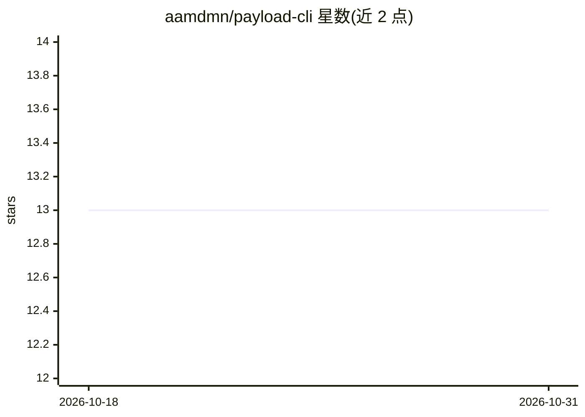

# aamdmn/payload-cli

⭐ 13 · TypeScript · MIT · 推送 2026-09-17 · [GitHub](https://github.com/aamdmn/payload-cli) · 个人维护

**面向 AI agent 的 PayloadCMS 命令行数据操作工具**

通过 Payload Local API 直接读写 CMS 数据库的 CLI，无需 HTTP 服务器、API key 或 MCP。命令覆盖集合发现、schema 描述、文档增删改查、批量操作、媒体上传下载与全局字段读写，支持 --json 机器可读输出、--dry-run 校验和本地化字段。面向 Opencode、Claude Code 等 AI 编码 agent 设计，也供人使用；附带 Claude Code 技能文件教 agent 执行 discover-describe-read-write-verify 工作流。要求 Node.js>=22.12.0 与 Payload CMS ^3.0.0。

## 筛选速览

| 维度 | 判定 | 备注 |
|---|---|---|
| AI 角色 | `ai-ecosystem` | LLM/agent 周边工具 |
| 许可风险 | `permissive` | MIT |
| 部署形态 | `library` | 以包/库形式分发 |
| 模型依赖 | — | README 未给出锁定关系 |
| 硬件要求 | — | 无带数字的原话,不猜 |
| 安装摩擦 | `low` | 无编译、无系统依赖或容器化 |
| 成熟度 | — | 结构信号不足 |

## 能力要点

- 经 Payload Local API 直连数据库，无需服务器与 API key
- 集合/文档/全局/媒体的完整读写命令集，含批量操作
- --json、--dry-run、--confirm 等 agent 友好标志
- skills/ 目录提供 Claude Code 技能文件

## 适用场景

- 让 AI 编码 agent 直接操作 PayloadCMS 项目数据
- 在脚本或终端中快速查询和修改 CMS 文档与媒体
- 批量上传目录内媒体文件并附加到文档字段

## 场景标签

 · 领域:CMS/开发工具

## 证据(README 行号)

> L2:  PayloadCMS automation CLI for AI agents
> L6: Built for AI coding agents (Opencode, Claude Code, etc.) but works great for humans too.

## 星数曲线

2026-10-18 13 → 2026-10-31 13（+0）

---
*卡片 v1 · prompt 1.4 · 生成 2026-10-31 · 置信度 high · 依据 README sha `e0fb3514b32d` · [字段定义](../../DATASET.md)*
