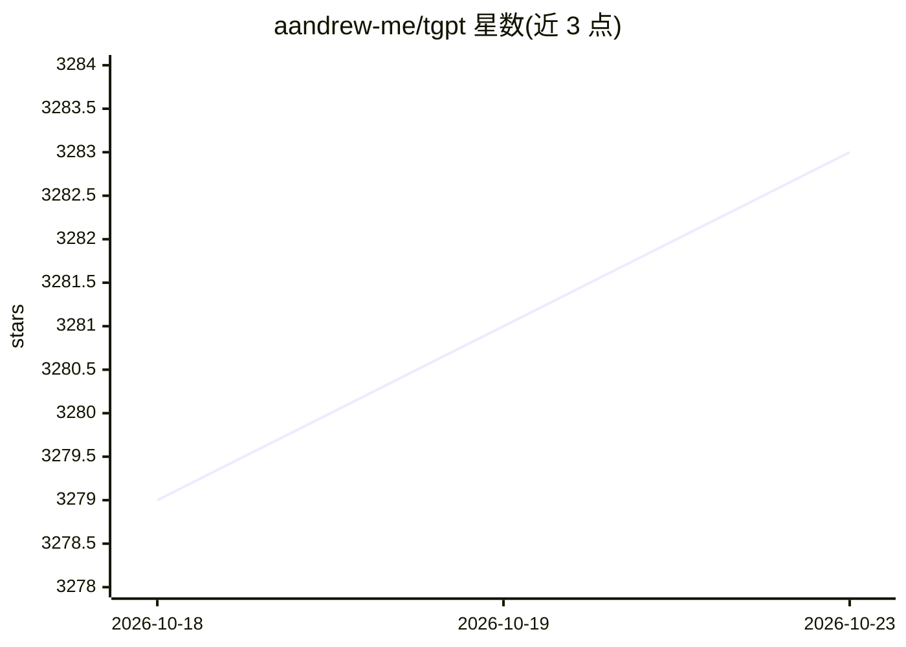

# aandrew-me/tgpt

⭐ 3,283 · Go · GPL-3.0 · 推送 2026-10-20 · [GitHub](https://github.com/aandrew-me/tgpt) · 个人维护

**跨平台终端 AI 聊天 CLI，无需 API key 即可用**

tgpt 是用 Go 编写的跨平台命令行工具，让用户在终端中使用 AI 对话，宣称无需 API key、免费使用，内置多个可用 provider，并提供 REPL 交互。安装途径覆盖 GNU/Linux（curl 安装脚本、pacman）、macOS（Homebrew）、FreeBSD（port/pkg）、Windows（PowerShell 脚本、Scoop、Chocolatey），也可通过 go install 或直接下载 Release 可执行文件。支持 HTTP/Socks5 代理（环境变量或配置文件方式），自带 tgpt -u 自更新与卸载流程。限制：README 未展示具体模型或后端细节。

## 筛选速览

| 维度 | 判定 | 备注 |
|---|---|---|
| AI 角色 | `ai-native` | 本体是模型或模型工具 |
| 许可风险 | `viral` | GPL-3.0 |
| 部署形态 | `library` | 以包/库形式分发 |
| 模型依赖 | — | README 未给出锁定关系 |
| 硬件要求 | — | 无带数字的原话,不猜 |
| 安装摩擦 | `medium` | 含编译或系统依赖之一 |
| 成熟度 | — | 结构信号不足 |

## 能力要点

- 终端内直接与 AI 对话，宣称无需 API key
- 多平台安装渠道（pacman/Homebrew/pkg/Scoop/Chocolatey/go install/安装脚本）
- 支持 HTTP/Socks5 代理（含认证），可经环境变量或配置文件设置
- 内置 tgpt -u 自更新命令

## 适用场景

- 在终端里快速向 AI 提问或对话
- 服务器等无图形界面环境使用 AI 助手
- 通过代理环境访问 AI 服务

## 场景标签

`聊天机器人` `AI 助手` · 领域:对话与助手

## 证据(README 行号)

> L11: **tgpt** is a Cross-platform Command-Line Interface (CLI) tool that allows you to use AI in your Terminal.
> L15: ### Currently available providers

## 星数曲线

2026-10-18 3,279 → 2026-10-23 3,283（+4）

---
*卡片 v1 · prompt 1.4 · 生成 2026-10-20 · 置信度 high · 依据 README sha `588f02628fc9` · [字段定义](../../DATASET.md)*
