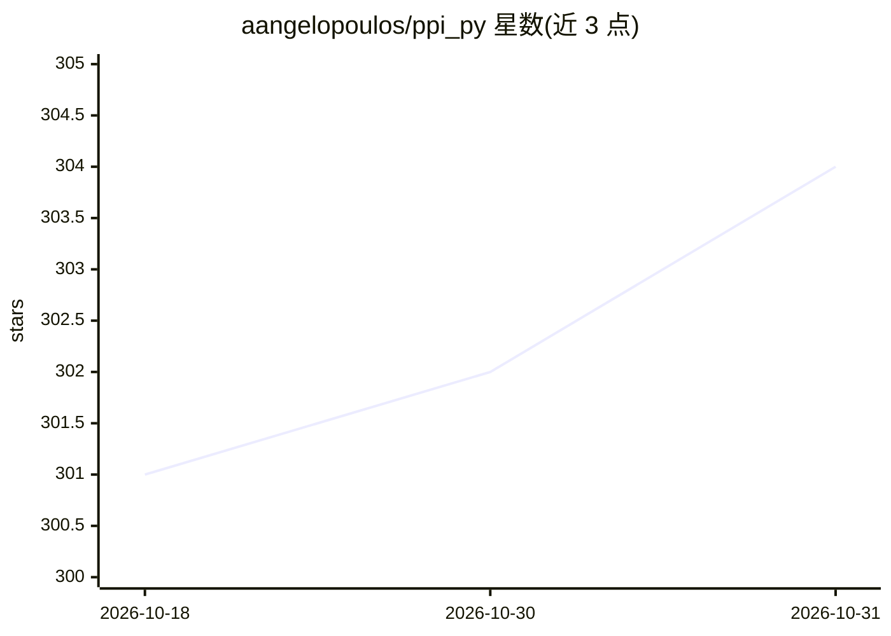

# aangelopoulos/ppi_py

⭐ 304 · Python · MIT · 推送 2026-04-10 · [GitHub](https://github.com/aangelopoulos/ppi_py) · 个人维护

**预测赋能推断（PPI）Python 库：用机器学习预测做统计推断**

实现 prediction-powered inference（PPI）的统计推断库：给定少量金标准标注数据和大量无标注数据（含模型预测），估计总体参数（均值、分位数、回归系数等），产出点估计、置信区间与 p 值，支持 i.i.d. 场景与部分分布偏移（协变量偏移、标签偏移）。API 统一为 ppi_[ESTIMAND]_ci/pointestimate 模板，含交叉预测推断与基线实现。附 11 个真实数据 notebook（AlphaFold、星系分类、基因表达、森林砍伐等）及功效分析脚本。由论文作者团队按多篇 PPI 论文方法实现维护。

## 筛选速览

| 维度 | 判定 | 备注 |
|---|---|---|
| AI 角色 | `ai-native` | 本体是模型或模型工具 |
| 许可风险 | `permissive` | MIT |
| 部署形态 | `library` | 以包/库形式分发 |
| 模型依赖 | — | README 未给出锁定关系 |
| 硬件要求 | — | 无带数字的原话,不猜 |
| 安装摩擦 | `low` | 无编译、无系统依赖或容器化 |
| 成熟度 | — | 结构信号不足 |

## 能力要点

- 统一 API 模板 ppi_[ESTIMAND]_ci/pointestimate 覆盖多种估计量
- 支持 i.i.d. 与分布偏移（协变量/标签偏移）设定
- cross-PPI 允许模型训练与推断使用同一数据
- 11 个真实数据示例 notebook 与标注/无标注预算的功效分析

## 适用场景

- 我只标注得起少量样本，想用模型预测得到更紧的置信区间
- 在分布偏移的数据上做均值或回归系数的统计推断
- 科学发现场景中把机器学习预测与假设检验结合

## 场景标签

 · 领域:统计/机器学习方法库

## 证据(README 行号)

> L1: Prediction-powered inference (PPI) is a framework for statistically rigorous scientific discovery using machine lear
> L2: Given a small amount of data with gold-standard labels and a large amount of unlabeled data, prediction-powered infe
> L3: Prediction-powered inference can be used both to produce better point estimates of these quantities as well as tight

## 星数曲线

2026-10-18 301 → 2026-10-31 304（+3）

---
*卡片 v1 · prompt 1.4 · 生成 2026-10-21 · 置信度 high · 依据 README sha `f56fdf2dfb8d` · [字段定义](../../DATASET.md)*
