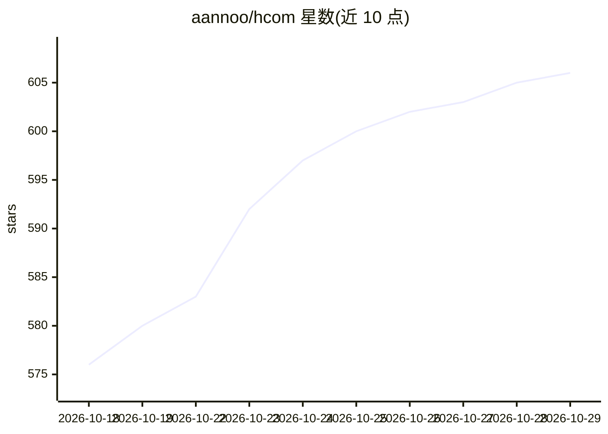

# aannoo/hcom

⭐ 606 · Rust · MIT · 推送 2026-10-21 · [GitHub](https://github.com/aannoo/hcom) · [官网](https://pypi.org/project/hcom/) · 个人维护

**跨终端连接各编码 agent CLI：互发消息、监控、派生**

用于协调独立编码代理的 CLI 工具：在 Claude Code、Codex、Gemini CLI、OpenCode、Cursor CLI 等 14 种 AI CLI 前加 `hcom` 前缀启动，代理之间即可实时互发消息、查看彼此状态与转录、订阅事件自动反应、以及 spawn/fork/resume/kill 代理。机制上通过 hooks 将活动记录到本地 SQLite 数据库并以之传递消息；无 hooks 的工具可用 `hcom start` 手动加入。支持 MQTT relay 跨设备连接，附 TUI 仪表盘与多代理工作流脚本（debate/onidle 等）。安装经 uv、brew 或安装脚本。

## 筛选速览

| 维度 | 判定 | 备注 |
|---|---|---|
| AI 角色 | `ai-ecosystem` | LLM/agent 周边工具 |
| 许可风险 | `permissive` | MIT |
| 部署形态 | `None` |  |
| 模型依赖 | locked-api |  |
| 硬件要求 | — | 无带数字的原话,不猜 |
| 安装摩擦 | `low` | 无编译、无系统依赖或容器化 |
| 成熟度 | — | 结构信号不足 |

## 能力要点

- 14 种 AI CLI 一键接入，代理间实时消息与事件订阅
- hooks + 本地 SQLite 实现活动记录与消息投递
- spawn/fork/resume/kill 代理，支持真实终端或 headless 后台
- MQTT relay 跨设备连接，内置 debate/onidle 等工作流脚本

## 适用场景

- 多个 AI CLI 代理分工协作完成同一工程任务
- 监控代理运行状态、token 用量并在空闲时自动派发下一任务
- 跨机器协调分布式运行的编码代理

## 场景标签

`多智能体` `Agent 框架` · 领域:Agent 开发

## 证据(README 行号)

> L5: Connect independent coding agents across terminals and machines. They can message each other, monitor activity, reac

## 星数曲线

2026-10-18 576 → 2026-10-29 606（+30）

---
*卡片 v1 · prompt 1.4 · 生成 2026-10-22 · 置信度 high · 依据 README sha `caa6ae8a23e4` · [字段定义](../../DATASET.md)*
