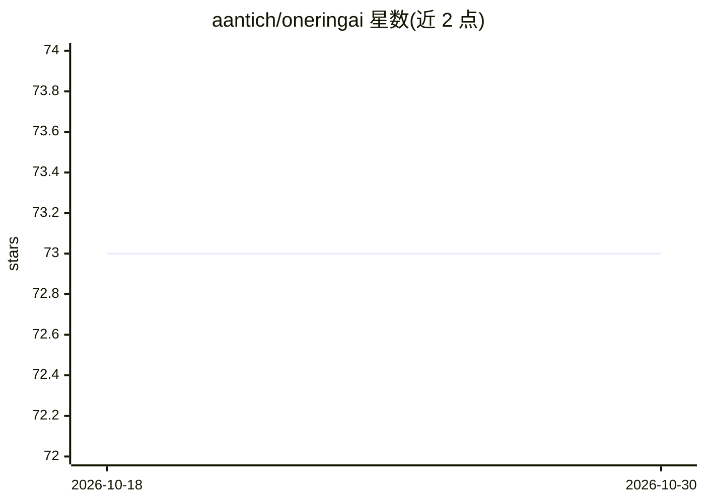

# aantich/oneringai

⭐ 73 · TypeScript · MIT · 推送 2026-10-28 · [GitHub](https://github.com/aantich/oneringai) · [官网](https://oneringai.io) · 组织维护

**统一多厂商 AI agent TypeScript 库：文本/图像/音频/工作流一体化**

TypeScript 编写的统一 AI agent 库，以 connector-first 认证方式接入 OpenAI、Anthropic、Google、xAI 四家厂商，覆盖文本生成、图像/视频生成、TTS/STT 与 agentic 工作流。提供 Agent Runtime（可运行原生 agent 或 OpenAI Codex SDK agent）、实体/事实图谱加向量检索的 MemorySystem、模块化上下文插件与工具目录（39 个内置工具、50 个连接器模板），并附 AMOS 终端助手示例。Agent Runtime 为本地预览，审批/转向功能尚未在本地实现，隔离容器执行在规划中。

## 筛选速览

| 维度 | 判定 | 备注 |
|---|---|---|
| AI 角色 | `ai-ecosystem` | LLM/agent 周边工具 |
| 许可风险 | `permissive` | MIT |
| 部署形态 | `library` | 以包/库形式分发 |
| 模型依赖 | locked-api |  |
| 硬件要求 | — | 无带数字的原话,不猜 |
| 安装摩擦 | `low` | 无编译、无系统依赖或容器化 |
| 成熟度 | `idea` | |

## 能力要点

- 四厂商（OpenAI/Anthropic/Google/xAI）统一 API 层，多模态覆盖文本、图像、音频
- Agent Runtime：同一 spec/session/run API 下可切换原生 agent 与 Codex SDK driver
- MemorySystem：图谱遍历+向量检索、实体消解、来源追溯、Mongo/Atlas 适配
- 50 个连接器模板与 39 个生成式内置工具，多账号命名隔离

## 适用场景

- 在 TypeScript 应用中用统一接口切换多家模型厂商与多模态能力
- 为应用构建带持久记忆与工具目录的 agent
- 让 Codex/Claude Code 等编码 agent 基于 Agent Guide 生成调用本库的代码

## 场景标签

`Agent 框架` `多模态` `模型网关` · 领域:Agent 开发

## 证据(README 行号)

> L3: > **A unified AI agent library with multi-provider support for text generation, image/video generation, audio (TTS/S
> L73: ## Agent Runtime: run complete agents through one API
> L75: The preview **Agent Runtime** is the integration layer for pre-built agent

## 星数曲线

2026-10-18 73 → 2026-10-30 73（+0）

---
*卡片 v1 · prompt 1.4 · 生成 2026-10-24 · 置信度 high · 依据 README sha `ae4c41458661` · [字段定义](../../DATASET.md)*
