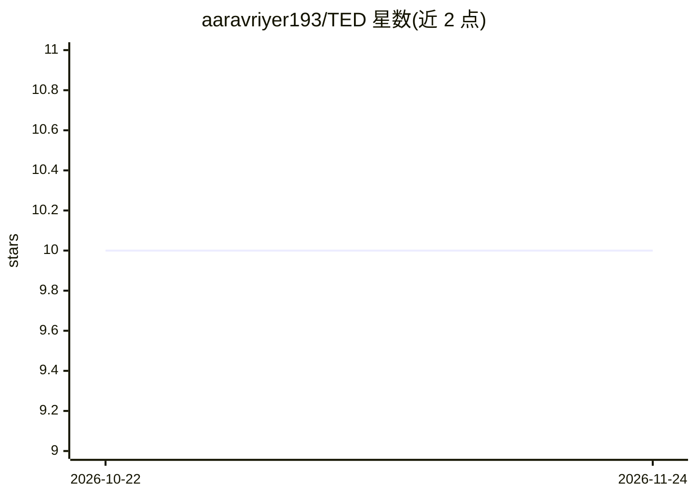

# aaravriyer193/TED

⭐ 10 · HTML · NOASSERTION · 推送 2026-04-11 · [GitHub](https://github.com/aaravriyer193/TED) · [官网](https://ted.walnutlabs.in) · 个人维护

**在 Linux 沙箱中自主运行的 AI agent 应用**

TED 是一个基于 Flask 的自主 AI agent 应用：用户为其提供 Linux 沙箱（默认 E2B）、任意 LLM（经 OpenRouter 调用）和预设人格，由其自主探索、执行任务。内置 13 种人格预设（安全研究、代码开发、数据分析等），人格提示可编辑；支持运行中注入消息、跨会话记忆传递、会话结束自动写日记、实时 token/成本统计，以及文件浏览器和会话导出。密钥与会话均存于浏览器本地，用户自带 API key。

## 筛选速览

| 维度 | 判定 | 备注 |
|---|---|---|
| AI 角色 | `ai-native` | 本体是模型或模型工具 |
| 许可风险 | `none` | NOASSERTION |
| 部署形态 | `library` | 以包/库形式分发 |
| 模型依赖 | locked-api |  |
| 硬件要求 | — | 无带数字的原话,不猜 |
| 安装摩擦 | `low` | 无编译、无系统依赖或容器化 |
| 成熟度 | — | 结构信号不足 |

## 能力要点

- 13 种内置人格预设，系统提示完全可编辑
- 跨会话记忆：每个会话结束时写下消息传给下一实例
- 30+ 集成模板（GitHub、Slack、Discord、Telegram 等）
- 100% 本地存储，密钥不离开浏览器

## 适用场景

- 让 agent 在沙箱中自主执行代码、克隆仓库并提交 PR
- 用安全研究人格做端口扫描与网络侦察
- 保存会话到画廊并浏览 agent 的自动日记

## 场景标签

`AI 助手` `编码 Agent` `网络安全` `数据分析` · 领域:效率与自动化

## 证据(README 行号)

> L3: > An open-source autonomous AI agent that gets a Linux box and does whatever it wants.
> L5: **TED** isn't an assistant. TED is an **entity**. You give it a body (a Linux sandbox), a brain (any LLM), and a pur
> L79: Browser (localStorage + IndexedDB) ←→ Flask (stateless) ←→ OpenRouter + E2B

## 星数曲线

2026-10-22 10 → 2026-11-24 10（+0）

---
*卡片 v1 · prompt 1.4 · 生成 2026-11-20 · 置信度 high · 依据 README sha `fcb418ee1d0d` · [字段定义](../../DATASET.md)*
