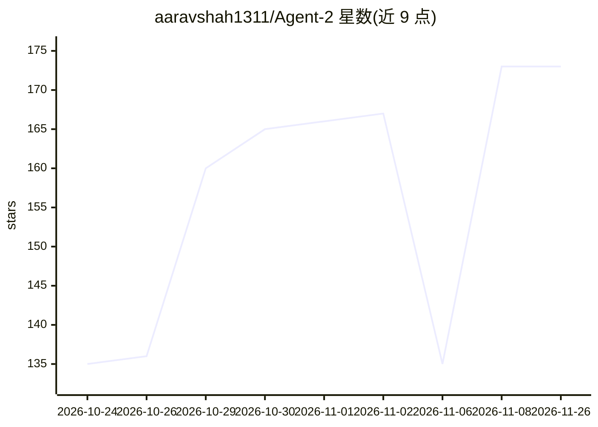

# aaravshah1311/Agent-2

⭐ 173 · Python · MIT · 推送 2026-11-18 · [GitHub](https://github.com/aaravshah1311/Agent-2) · 个人维护

**本地运行自主编码/终端/安全任务 AI Agent 工具**

运行在用户本机的自主 AI Agent 工具，使用用户自己的 Gemini API key，状态存于单个 SQLite 文件（agent2.db），无账号、无遥测。提供 CLI、Web UI、Dual 三种入口，共享同一系统提示词、工具分发器、模型路由与数据库。内置 18 个工具（命令执行、文件读写、目录扫描、web 搜索等），支持 MCP 桥接（Burp Suite/OWASP ZAP）、DAG 工作流、任务检查点恢复，以及全离线的 Personal Intelligence 层（trie/n-gram 预测，不调用 LLM）。要求 Python 3.9+。

## 筛选速览

| 维度 | 判定 | 备注 |
|---|---|---|
| AI 角色 | `ai-native` | 本体是模型或模型工具 |
| 许可风险 | `permissive` | MIT |
| 部署形态 | `self-host` | docker 或自建部署 |
| 模型依赖 | — | README 未给出锁定关系 |
| 硬件要求 | — | 无带数字的原话,不猜 |
| 安装摩擦 | `low` | 无编译、无系统依赖或容器化 |
| 成熟度 | — | 结构信号不足 |

## 能力要点

- CLI/Web/Dual 三入口共享同一工具分发器、记忆与数据库
- 18 个 agent 工具含命令执行、文件智能与 web 搜索
- 支持 OpenAI/Anthropic 兼容自定义端点与模型路由（opt-in）
- DAG 工作流与检查点恢复，全离线 Personal Intelligence 层

## 适用场景

- 让 Agent 自主编写和调试代码并管理项目文件
- 自动化终端命令执行与文件格式处理
- 安全研究场景下接入 Burp/ZAP 工具执行任务
- 将目标语句转成多步骤工作流图自动执行

## 场景标签

`编码 Agent` `网络安全` `浏览器自动化` · 领域:效率与自动化

## 证据(README 行号)

> L3:  An autonomous AI agentic harness built to code anything, automate terminals, perform cybersecurity tasks, and execu
> L36: Agent-2 runs on your machine, talks to Google Gemini with your own API keys, and keeps
> L102: **Core (13)** — `run_command`, `read_file`, `write_file`, `multi_edit_files`, `list_dir`,

## 星数曲线

2026-10-24 135 → 2026-11-26 173（+38）

---
*卡片 v1 · prompt 1.4 · 生成 2026-11-26 · 置信度 mid · 依据 README sha `689b6d5fd610` · [字段定义](../../DATASET.md)*
