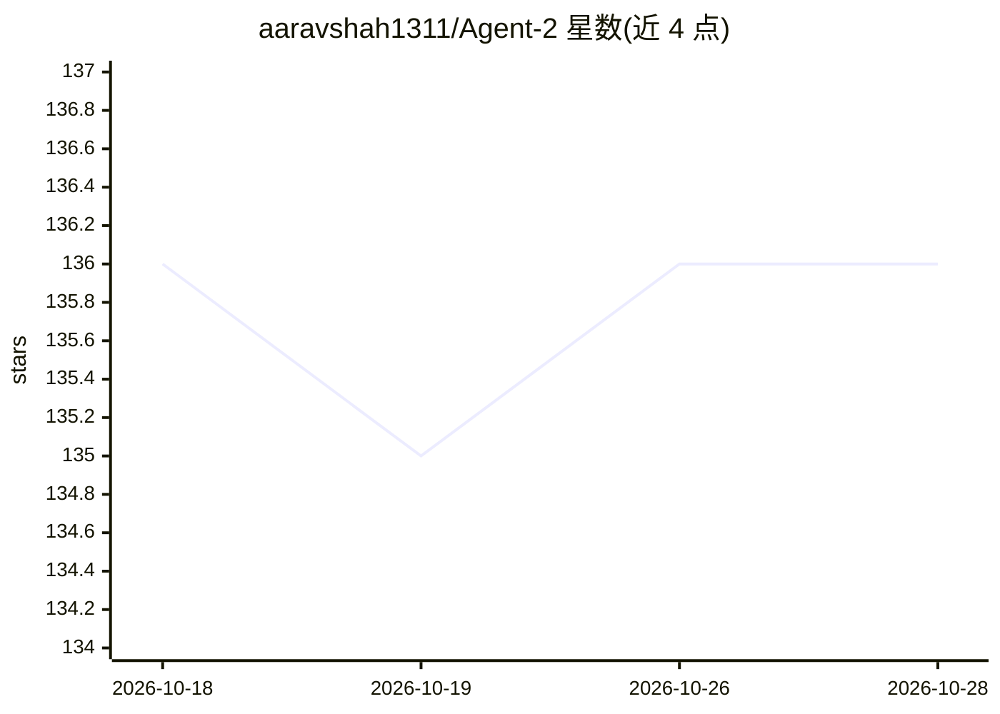

# aaravshah1311/Agent-2

⭐ 136 · Python · MIT · 推送 2026-10-25 · [GitHub](https://github.com/aaravshah1311/Agent-2) · [官网](https://agent2.is-best.net) · 个人维护

**本地运行的自主 AI agent 框架：用 Gemini 编码与执行终端任务**

运行在用户本机的自主 agentic harness，通过用户自有 Gemini API key 与模型通信，状态全部存于本地 agent2.db，无账户/服务/遥测。提供 CLI、Web UI、双模式三种界面，共享同一系统提示、工具分发器、记忆与模型路由。内置 18 个工具（命令执行、文件读写、搜索等），支持 OpenAI/Anthropic 兼容自定义端点、MCP 桥接 Burp Suite/ZAP、DAG 工作流与 UltraCode 自主循环。需要 Python 3.9+，git clone 后以 run.py 启动。

## 筛选速览

| 维度 | 判定 | 备注 |
|---|---|---|
| AI 角色 | `ai-ecosystem` | LLM/agent 周边工具 |
| 许可风险 | `permissive` | MIT |
| 部署形态 | `self-host` | docker 或自建部署 |
| 模型依赖 | — | README 未给出锁定关系 |
| 硬件要求 | — | 无带数字的原话,不猜 |
| 安装摩擦 | `low` | 无编译、无系统依赖或容器化 |
| 成熟度 | — | 结构信号不足 |

## 能力要点

- 18 个内置 agent 工具，含命令执行、多文件编辑、工作区搜索
- CLI/Web/Dual 三种界面共享同一状态库 agent2.db
- 支持 OpenAI/Anthropic 兼容端点与 Burp Suite/ZAP MCP 桥接
- DAG 工作流、检查点任务恢复与 UltraCode 自主循环

## 适用场景

- 让 agent 自主编写与调试代码、执行终端命令
- 通过浏览器或终端多界面管理自动化工作流
- 结合 Burp/ZAP 执行网络安全分析任务

## 场景标签

`Agent 框架` `编码 Agent` `网络安全` · 领域:Agent 开发

## 证据(README 行号)

> L3:  An autonomous AI agentic harness built to code anything, automate terminals, perform cybersecurity tasks, and execu
> L33: Agent-2 runs on your machine, talks to Google Gemini with your own API keys, and keeps
> L158: Any OpenAI- or Anthropic-compatible endpoint (base URL + key + model id + format) appears in

## 星数曲线

2026-10-18 136 → 2026-10-28 136（+0）

---
*卡片 v1 · prompt 1.4 · 生成 2026-10-22 · 置信度 high · 依据 README sha `ecce48c86dac` · [字段定义](../../DATASET.md)*
