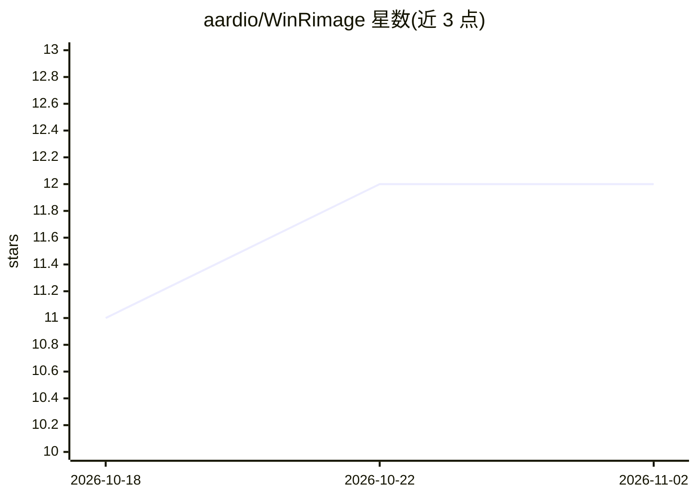

# aardio/WinRimage

⭐ 12 · MIT · 推送 2026-09-07 · [GitHub](https://github.com/aardio/WinRimage) · [官网](https://aau.cn) · 组织维护 · 中文 README

**基于 aardio 与 rimage 的 Windows 图像压缩转换 GUI**

面向 Windows 用户的图像转换与压缩图形界面，底层调用 rimage 命令行工具（内置官方 v0.13.0 二进制）。界面分为单图处理页（真实编码输出预览、剪贴板读写）与批量处理页（队列管理、异步处理、取消与进度），支持 mozjpeg/jpeg/webp/avif/png 等 10 种输出格式及缩放、量化、抖动参数。参数校验与安全检查由 process.rimage 统一负责，默认输出到独立目录不覆盖输入。项目由 AI 智能体 AA(aardio autos) 宣称全自主开发，附 48 项自动测试结果。需 aardio 开发环境运行工程。

## 筛选速览

| 维度 | 判定 | 备注 |
|---|---|---|
| AI 角色 | `ai-enhanced` | 去掉 AI 部分产品仍成立 |
| 许可风险 | `permissive` | MIT |
| 部署形态 | `desktop` | 安装包/桌面程序 |
| 模型依赖 | — | README 未给出锁定关系 |
| 硬件要求 | — | 无带数字的原话,不猜 |
| 安装摩擦 | `low` | 无编译、无系统依赖或容器化 |
| 成熟度 | — | 结构信号不足 |

## 能力要点

- 单图页生成真实编码输出预览而非 GDI+ 模拟
- 批量页支持队列去重、异步处理、取消与成败摘要
- 支持 10 种输出格式与 7 种缩放算法
- 参数与安全检查由 process.rimage 统一负责，不直接拼接命令行

## 适用场景

- 压缩或转换单张图片并实时预览编码效果
- 按统一规则批量处理文件夹内多张图片
- 调整颜色量化与抖动减小图像体积

## 场景标签

`图像视频处理` · 领域:感知与多模态

## 证据(README 行号)

> L3: > 本项目由 AI 智能体 AA(aardio autos) 全自主开发完成（包含全部代码、界面、文档）。
> L5: WinRimage 是一个基于 aardio 和 rimage 的 Windows 图像转换 GUI。它把“单张图像调参预览”和“多文件批处理”拆成两个独立工作区：单图页专注于看效果，批量页专注于管理队列和任务结果。

## 星数曲线

2026-10-18 11 → 2026-11-02 12（+1）

---
*卡片 v1 · prompt 1.4 · 生成 2026-11-01 · 置信度 mid · 依据 README sha `9253f071c122` · [字段定义](../../DATASET.md)*
