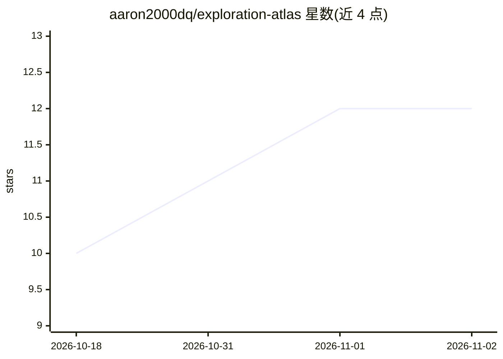

# aaron2000dq/exploration-atlas

⭐ 12 · JavaScript · MIT · 推送 2026-09-05 · [GitHub](https://github.com/aaron2000dq/exploration-atlas) · 个人维护 · 中文 README

**可离线运行的位置解锁活点地图模板：生日与城市探索路线**

基于 React/TypeScript/Vite 的 PWA 模板，把真实城市路线做成逐关揭晓的探索地图：抵达指定半径后解锁礼物与内容，支持手绘地图实时定位、照片匹配任务、离线 Service Worker 缓存与应急控制台。仓库内置脱敏的杭州示例（3 张地图、5 个坐标）。AI 参与体现在两方面：通过 Codex 等 AI 编程工具按提示词自动生成新地图配置（查坐标、核对步行路线、生成文案），运行时使用 MediaPipe Tasks Vision 做照片匹配。需 Node.js 22.13+，定位/离线能力要求 HTTPS 部署在域名根路径。

## 筛选速览

| 维度 | 判定 | 备注 |
|---|---|---|
| AI 角色 | `ai-enhanced` | 去掉 AI 部分产品仍成立 |
| 许可风险 | `permissive` | MIT |
| 部署形态 | `library` | 以包/库形式分发 |
| 模型依赖 | — | README 未给出锁定关系 |
| 硬件要求 | — | 无带数字的原话,不猜 |
| 安装摩擦 | `low` | 无编译、无系统依赖或容器化 |
| 成熟度 | — | 结构信号不足 |

## 能力要点

- 抵达指定半径（30 米级）后逐关揭晓地点与礼物的位置解锁机制
- PWA 离线运行：进度、照片与视觉模型保存在设备端（IndexedDB + Service Worker）
- 提供发给 AI 编程工具的提示词，由 AI 查地点、核步行路线并生成新地图配置
- 内置脱敏杭州示例与 npm run verify 完整校验流程

## 适用场景

- 为生日、纪念日、求婚或城市寻宝制作私人探索路线
- 在抵达前隐藏地点与礼物，进入半径后揭晓
- 让 AI 根据地点与礼物清单自动生成一套新地图

## 场景标签

 · 领域:互动地图/活动体验

## 证据(README 行号)

> L39: - 为生日、纪念日、求婚或城市寻宝制作一条私人探索路线。
> L179: React、TypeScript、Vite、Motion、MediaPipe Tasks Vision、IndexedDB、Service Worker、Vitest 和 Playwright。

## 星数曲线

2026-10-18 10 → 2026-11-02 12（+2）

---
*卡片 v1 · prompt 1.4 · 生成 2026-11-01 · 置信度 high · 依据 README sha `2bdee25a0bb9` · [字段定义](../../DATASET.md)*
