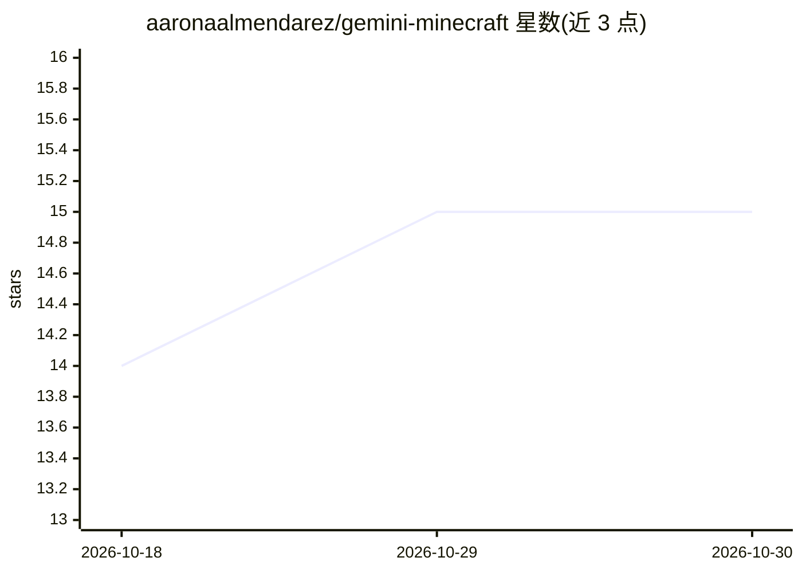

# aaronaalmendarez/gemini-minecraft

⭐ 15 · Java · MIT · 推送 2026-03-19 · [GitHub](https://github.com/aaronaalmendarez/gemini-minecraft) · 个人维护

**Minecraft Fabric 模组：Gemini 驱动的游戏内 AI 伴侣**

面向 Minecraft 1.21.1 Fabric 的模组，将 Google Gemini 接入游戏：玩家通过语音 Push-to-Talk 或 /chat 命令对话，AI 可执行游戏命令、进行结构化建造（build_plan 管线，含地形扫描、分阶段施工与快照回滚）、截图视觉分析、递归推理与命令失败自修复。另提供默认关闭的 localhost MCP 桥，可将 Minecraft 暴露为 Codex、Claude Desktop、Claude Code 等桌面 agent 的工具服务。需 Java 21、Fabric Loader 与 Gemini API Key，以 JAR 形式安装到 mods 目录。

## 筛选速览

| 维度 | 判定 | 备注 |
|---|---|---|
| AI 角色 | `ai-native` | 本体是模型或模型工具 |
| 许可风险 | `permissive` | MIT |
| 部署形态 | `None` |  |
| 模型依赖 | — | README 未给出锁定关系 |
| 硬件要求 | — | 无带数字的原话,不猜 |
| 安装摩擦 | `medium` | 含编译或系统依赖之一 |
| 成熟度 | — | 结构信号不足 |

## 能力要点

- 结构化 build_plan 建造管线：地形扫描、分阶段施工、校验与快照回滚
- 语音 Push-to-Talk 转写与 /chat 命令终端，递归推理与命令失败自动重试
- localhost MCP 桥（bearer-token 认证，默认关闭），支持 Codex/Claude Desktop/Claude Code 等客户端
- 多玩家白名单/黑名单权限与 /chat setup 配置向导

## 适用场景

- 在游戏内用语音或文字让 AI 代为建造与执行命令
- 通过 MCP 把 Minecraft 接入外部桌面 agent 作为工具环境
- 服务器为玩家提供有权限控制的 AI 伴侣功能

## 场景标签

`语音识别` `AI 助手` · 领域:对话与助手

## 证据(README 行号)

> L46: - **Real-Time Voice Transcription**: Issue complex commands via voice audio—transcribed and executed instantly.
> L8: Gemini 3.1 Pro Preview
> L14: ### *“The first AI that doesn't just talk to you—it lives in your world.”*

## 星数曲线

2026-10-18 14 → 2026-10-30 15（+1）

---
*卡片 v1 · prompt 1.4 · 生成 2026-10-30 · 置信度 high · 依据 README sha `da03e29726a2` · [字段定义](../../DATASET.md)*
