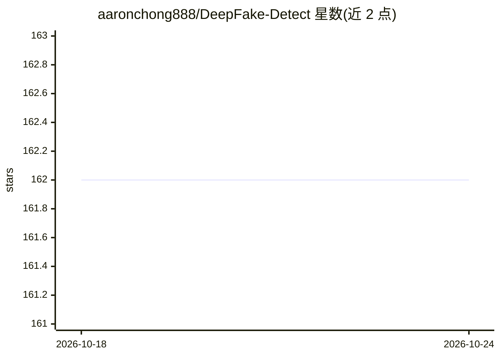

# aaronchong888/DeepFake-Detect

⭐ 162 · Python · MIT · 推送 2026-03-19 · [GitHub](https://github.com/aaronchong888/DeepFake-Detect) · [官网](https://deepfake-detect.com/) · 个人维护

**开源深度伪造检测训练管线：TensorFlow/Keras/EfficientNet**

用于从零训练深度伪造与人脸伪造检测模型的开源管线，基于 Python、Keras、TensorFlow 与 EfficientNet B0 骨干网络，将检测任务建模为 128×128 人脸图像的二分类问题。管线覆盖帧提取、人脸裁剪（MTCNN 或可选 Azure Computer Vision API）、数据集平衡与划分、模型训练四步，支持 FaceForensics++、Celeb-DF、DFDC、DFDC、DFD、DeepFake-TIMIT 五个公开数据集，并可通过 deepfake-detect.com 在线试用。用户可将自己的数据与公开数据集混合训练。

## 筛选速览

| 维度 | 判定 | 备注 |
|---|---|---|
| AI 角色 | `ai-native` | 本体是模型或模型工具 |
| 许可风险 | `permissive` | MIT |
| 部署形态 | `None` |  |
| 模型依赖 | — | README 未给出锁定关系 |
| 硬件要求 | — | 无带数字的原话,不猜 |
| 安装摩擦 | `low` | 无编译、无系统依赖或容器化 |
| 成熟度 | — | 结构信号不足 |

## 能力要点

- EfficientNet B0 骨干 + 全局最大池化 + Sigmoid 二分类头
- 四步端到端管线：帧提取→人脸裁剪→数据平衡划分→训练
- 支持 5 个公开深度伪造数据集、约 20 种合成方法
- 提供 deepfake-detect.com 在线演示

## 适用场景

- 用自己的数据集训练深度伪造检测模型
- 检测人脸图像是否为深度伪造（在线演示或运行训练好的模型）
- 在公开基准数据上复现深度伪造检测训练流程

## 场景标签

`人脸识别` · 领域:感知与多模态

## 证据(README 行号)

> L18: **DeepFake-Detect** is an open-source pipeline for training **deepfake detection** and **face forgery detection** m
> L130: EfficientNet is used as the backbone for the development work. Given that most of the deepfake videos are synthesi

## 星数曲线

2026-10-18 162 → 2026-10-24 162（+0）

---
*卡片 v1 · prompt 1.4 · 生成 2026-10-22 · 置信度 high · 依据 README sha `6dea8f099476` · [字段定义](../../DATASET.md)*
