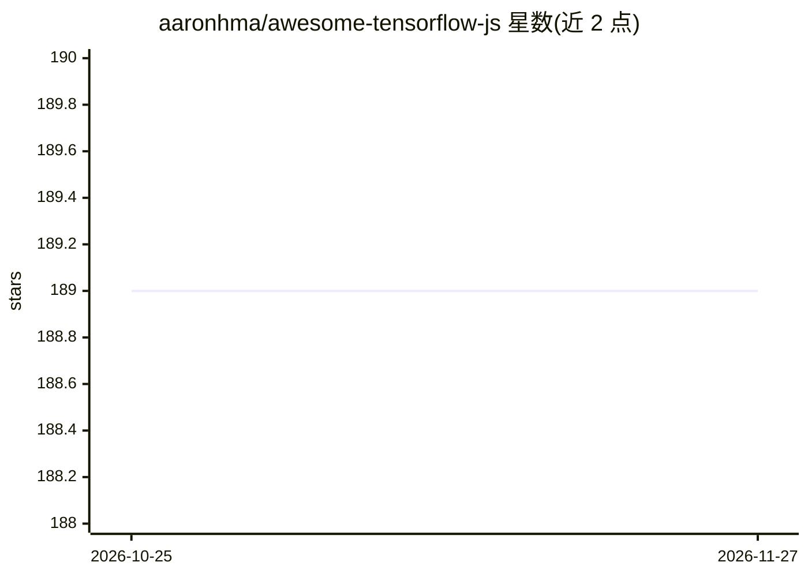

# aaronhma/awesome-tensorflow-js

⭐ 189 · CC0-1.0 · 推送 2026-10-31 · [GitHub](https://github.com/aaronhma/awesome-tensorflow-js) · [官网](https://www.tensorflow.org/js/) · 个人维护

**为 JavaScript 开发者收录 TensorFlow.js 学习与项目资源**

收录 TensorFlow.js 相关资源的策展清单，按文档、教程、模型/项目、论文、视频、书籍、博客、社区等类别组织，条目附一行说明。内容覆盖在浏览器与 Node.js 中训练与部署机器学习模型的学习路径，并收录使用该库的展示项目（如图像分类、姿态分割、人脸检测库等）与工具链接。社区部分列出贡献方式与废弃条目的移除标准，要求贡献者遵守行为准则。

## 筛选速览

| 维度 | 判定 | 备注 |
|---|---|---|
| AI 角色 | `ai-knowledge` | 知识聚合/清单类 |
| 许可风险 | `viral` | CC0-1.0 |
| 部署形态 | `None` |  |
| 模型依赖 | — | README 未给出锁定关系 |
| 硬件要求 | — | 无带数字的原话,不猜 |
| 安装摩擦 | `low` | 无编译、无系统依赖或容器化 |
| 成熟度 | — | 结构信号不足 |

## 能力要点

- 按文档/教程/模型/论文/视频/书籍/工具等类别组织的策展清单
- 收录官方预训练模型仓库与 NPM 上的 @tensorflow-models 包
- 列出基于 TensorFlow.js 的展示项目与在线工具
- 提供条目废弃移除标准（明确停止维护或长期未提交）

## 适用场景

- 想用 JavaScript 在浏览器里训练或运行机器学习模型时查找学习资料
- 寻找可直接使用的 TensorFlow.js 预训练模型与示例项目
- 为前端项目挑选人脸检测、手部检测等现成库

## 场景标签

`精选清单` · 领域:学习与行业

## 证据(README 行号)

> L1: # Awesome TensorFlowJS Awesome
> L6: This list is a collection of the best TensorFlow.js tools, resources, videos and shiny things.

## 星数曲线

2026-10-25 189 → 2026-11-27 189（+0）

---
*卡片 v1 · prompt 1.4 · 生成 2026-11-26 · 置信度 high · 依据 README sha `49d19e7b3758` · [字段定义](../../DATASET.md)*
