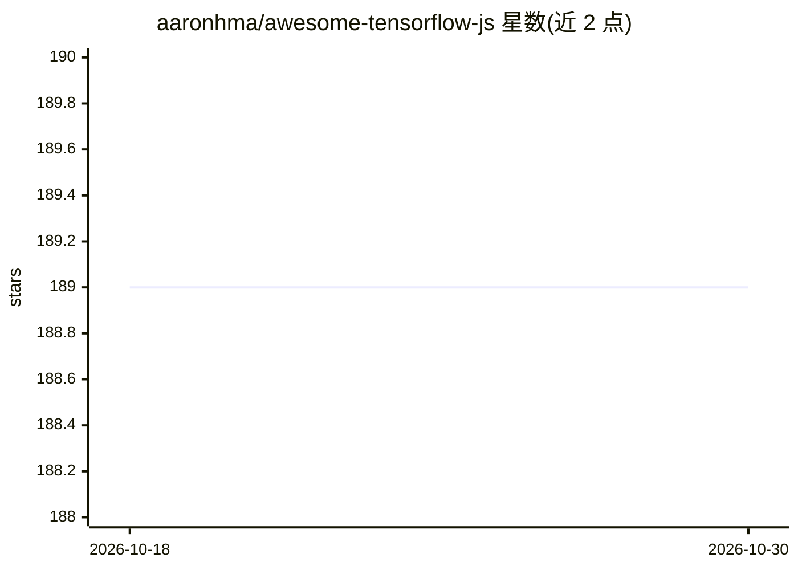

# aaronhma/awesome-tensorflow-js

⭐ 189 · CC0-1.0 · 推送 2026-10-27 · [GitHub](https://github.com/aaronhma/awesome-tensorflow-js) · [官网](https://www.tensorflow.org/js/) · 个人维护

**TensorFlow.js 学习资源策展清单：教程/模型/书籍/工具汇总**

由个人维护的 TensorFlow.js 资源聚合清单，收录官方文档、教程、预训练模型仓库、论文、视频、书籍、博客，以及基于 TensorFlow.js 构建的项目展示（如 NSFWJS、Pose Animator、BodyPix）。另列出 ml5.js、face-api.js、handtrack.js 等相关库与 Teachable Machine、TensorFlow Playground 等在线工具，并提供社区渠道与贡献指南（含条目弃用判定规则）。清单本身不含可安装代码。

## 筛选速览

| 维度 | 判定 | 备注 |
|---|---|---|
| AI 角色 | `ai-knowledge` | 知识聚合/清单类 |
| 许可风险 | `viral` | CC0-1.0 |
| 部署形态 | `None` |  |
| 模型依赖 | — | README 未给出锁定关系 |
| 硬件要求 | — | 无带数字的原话,不猜 |
| 安装摩擦 | `low` | 无编译、无系统依赖或容器化 |
| 成熟度 | — | 结构信号不足 |

## 能力要点

- 分类收录 TensorFlow.js 教程、论文、视频与书籍
- 列出 @tensorflow-models 等 NPM 预训练模型与官方示例仓库
- 收录基于 TensorFlow.js 的项目（NSFWJS/Pose Animator/BodyPix 等）与相关库
- 定义了条目弃用判定规则与贡献流程

## 适用场景

- 系统查找 TensorFlow.js 的学习路径与官方资源
- 为浏览器端 ML 项目寻找相关库与预训练模型
- 了解社区基于 TensorFlow.js 构建的项目案例

## 场景标签

`精选清单` · 领域:学习与行业

## 证据(README 行号)

> L3: TensorFlow.js is an open source software library to develop machine learning models in JavaScript, and use machine l
> L6: This list is a collection of the best TensorFlow.js tools, resources, videos and shiny things.

## 星数曲线

2026-10-18 189 → 2026-10-30 189（+0）

---
*卡片 v1 · prompt 1.4 · 生成 2026-10-22 · 置信度 high · 依据 README sha `b833d6e947ec` · [字段定义](../../DATASET.md)*
