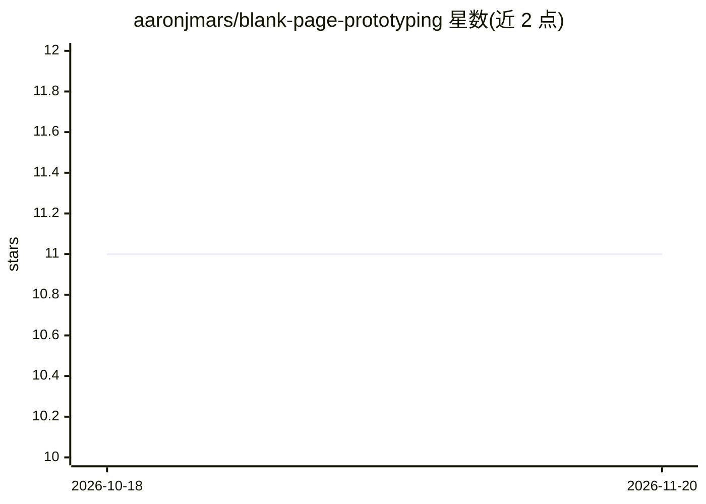

# aaronjmars/blank-page-prototyping

⭐ 11 · JavaScript · 推送 2026-11-05 · [GitHub](https://github.com/aaronjmars/blank-page-prototyping) · 个人维护

**拍照上传手绘页面草图，GPT-4o 生成 HTML 原型**

Next.js 应用：通过手机或摄像头拍摄手绘/打印的页面草图，图像以 base64 发送到 OpenAI GPT-4o，返回的 HTML 直接作为生成的网页展示。需要 Node.js 22+ 和 OpenAI API key，开发服务器监听所有网络接口；受浏览器限制，手机端访问需 HTTPS 隧道或部署。生成行为可通过修改 API 路由中的 prompt 或 max_tokens 调整。

## 筛选速览

| 维度 | 判定 | 备注 |
|---|---|---|
| AI 角色 | `ai-native` | 本体是模型或模型工具 |
| 许可风险 | `none` | — |
| 部署形态 | `library` | 以包/库形式分发 |
| 模型依赖 | — | README 未给出锁定关系 |
| 硬件要求 | — | 无带数字的原话,不猜 |
| 安装摩擦 | `low` | 无编译、无系统依赖或容器化 |
| 成熟度 | — | 结构信号不足 |

## 能力要点

- 手机/摄像头拍摄草图直接生成 HTML 网页
- 图像 base64 发送至 GPT-4o 生成页面
- 可编辑 prompt 与 max_tokens 调整生成方式
- dev server 监听 0.0.0.0，局域网设备可访问

## 适用场景

- 把纸上手绘的页面草图快速转成可浏览的 HTML 原型
- 产品讨论时拍照演示页面布局
- 本地跑起来后让局域网内的其他设备试用生成结果

## 场景标签

`代码生成` · 领域:编码与开发

## 证据(README 行号)

> L9: - Generate a simple HTML website based on the content.
> L15: 3. The image is sent as base64 to `pages/api/generate-html.js`, which asks `gpt-4o` to turn it into HTML.

## 星数曲线

2026-10-18 11 → 2026-11-20 11（+0）

---
*卡片 v1 · prompt 1.4 · 生成 2026-11-18 · 置信度 high · 依据 README sha `f72d710e9257` · [字段定义](../../DATASET.md)*
