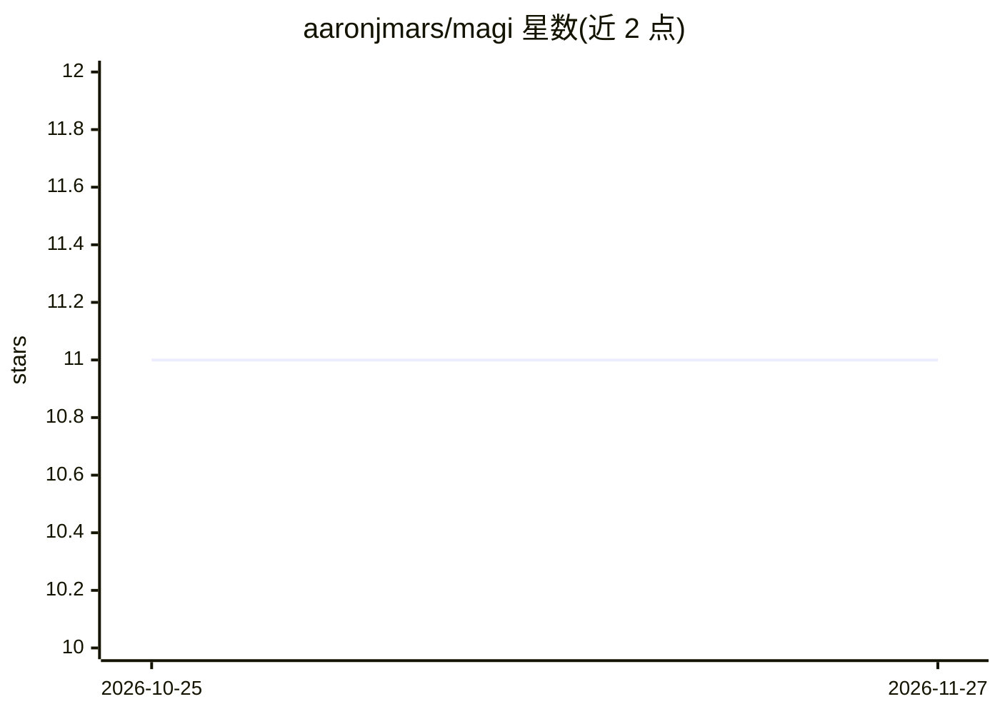

# aaronjmars/magi

⭐ 11 · JavaScript · 推送 2026-11-21 · [GitHub](https://github.com/aaronjmars/magi) · 个人维护

**Farcaster 的 meme 语义搜索引擎：AI 驱动的表情包检索 UI**

面向 Farcaster 社区的 meme 搜索引擎，前端为 Next.js 搜索界面，底层查询名为 `magi` 的 Typesense 索引；索引中每条 meme 带有 image_text、cast_caption、image_content 等文本字段供语义检索，图片由 Cloudflare Images 托管。README 明确说明构建索引的脚本不在本仓库内，运行需自备 Typesense 集合，并提供 Farcaster Frames 分享与 composer action（搜索 meme 并附加到正在编写的 cast）。

## 筛选速览

| 维度 | 判定 | 备注 |
|---|---|---|
| AI 角色 | `ai-native` | 本体是模型或模型工具 |
| 许可风险 | `none` | — |
| 部署形态 | `library` | 以包/库形式分发 |
| 模型依赖 | — | README 未给出锁定关系 |
| 硬件要求 | — | 无带数字的原话,不猜 |
| 安装摩擦 | `low` | 无编译、无系统依赖或容器化 |
| 成熟度 | — | 结构信号不足 |

## 能力要点

- 基于 Typesense 文本字段（image_text/image_content 等）的 AI 语义搜索
- Farcaster Frames 集成用于分享 meme
- composer action：搜索 meme 并附加到正在编写的 cast
- 支持 Farcaster、Degen、Higher、Enjoy 多个 meme 集合

## 适用场景

- 在 Farcaster 上语义搜索想要的 meme 并一键附加到 cast
- 通过 Frames 分享 meme 给社区
- 托管多个 meme 集合的检索界面

## 场景标签

`语义搜索` · 领域:知识与检索

## 证据(README 行号)

> L3: AI-powered meme search engine for Farcaster.
> L7: - Search memes using AI-powered semantic search
> L14: The web app is a search UI on top of a Typesense collection named `magi`. Each meme in the index has text fields (`

## 星数曲线

2026-10-25 11 → 2026-11-27 11（+0）

---
*卡片 v1 · prompt 1.4 · 生成 2026-11-18 · 置信度 mid · 依据 README sha `099b12e40fbd` · [字段定义](../../DATASET.md)*
