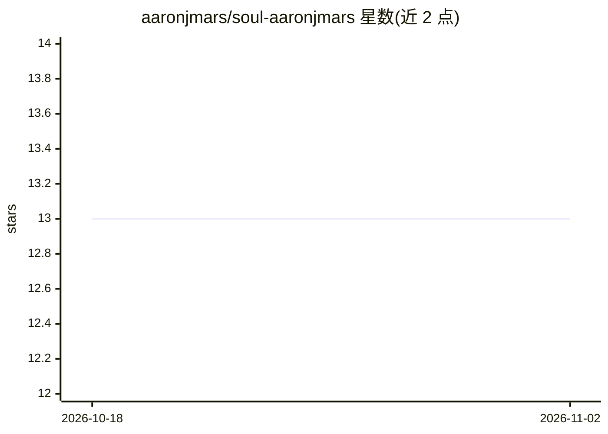

# aaronjmars/soul-aaronjmars

⭐ 13 · JavaScript · MIT · 推送 2026-10-15 · [GitHub](https://github.com/aaronjmars/soul-aaronjmars) · 个人维护

**让 LLM 以特定真人口吻思考与回应的人格档案框架**

一套数字身份规范文件集：包含 SOUL.md（身份/世界观/观点）、STYLE.md（写作风格）、SKILL.md（运行指令）、examples/ 校准材料与 data/ 原始语料（推文存档、Substack 文章、思想影响）。将文件夹喂给 LLM 后，模型以该身份（Aaron Elijah Mars）而非'关于该人'的方式回应。规定了阅读顺序、插值规则（从已知立场外推新话题观点）、五种模式（Tweet/Chat/Essay/Simulation/Idea Generation）及反模式清单。README 同时给出手工分叉构建自己 soul 文件的七步流程，并指向自动化工具 soul.md。MIT 许可。

## 筛选速览

| 维度 | 判定 | 备注 |
|---|---|---|
| AI 角色 | `ai-native` | 本体是模型或模型工具 |
| 许可风险 | `permissive` | MIT |
| 部署形态 | `None` |  |
| 模型依赖 | — | README 未给出锁定关系 |
| 硬件要求 | — | 无带数字的原话,不猜 |
| 安装摩擦 | `low` | 无编译、无系统依赖或容器化 |
| 成熟度 | — | 结构信号不足 |

## 能力要点

- SOUL/STYLE/SKILL 三层文件结构 + examples 与 data 双语料目录
- 插值规则：对未覆盖话题从世界观外推立场而非保持中立
- 五种输出模式：Tweet/Chat/Essay/Simulation/Idea Generation
- README 提供手工构建自己人格档案的七步指南

## 适用场景

- 让 Claude Code / OpenClaw 等 agent 以我的口吻与观点回应
- 为自己或他人构建可复用的数字身份（digital twin）文件集
- 作为构建个人 AI 人格的模板进行分叉与定制

## 场景标签

`提示工程` · 领域:Agent 开发

## 证据(README 行号)

> L3: A framework for creating embodied digital identities. Feed it to an LLM, and it becomes that person.
> L9: This folder contains a digital identity specification. When an LLM reads this, it doesn't just respond *about* the p
> L129: - The LLM IS Aaron for the duration of the interaction

## 星数曲线

2026-10-18 13 → 2026-11-02 13（+0）

---
*卡片 v1 · prompt 1.4 · 生成 2026-10-31 · 置信度 mid · 依据 README sha `8f7fbc2c855d` · [字段定义](../../DATASET.md)*
