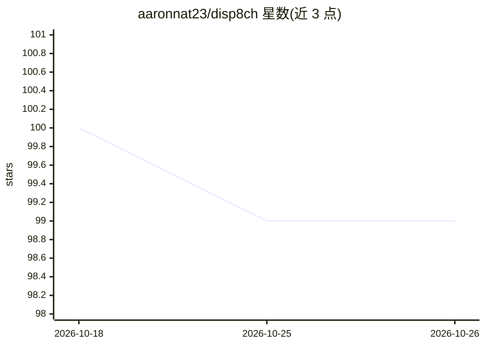

# aaronnat23/disp8ch

⭐ 99 · TypeScript · MIT · 推送 2026-09-02 · [GitHub](https://github.com/aaronnat23/disp8ch) · 个人维护

**本地优先的自托管 AI 工作区：对话驱动工作流与多智能体**

面向个人运营者的自托管 AI 工作区应用：以自然语言对话（WebChat）为控制面，生成可视化节点工作流（触发器、调度、重放），组织多智能体协作（Council 辩论表决、Hierarchy 角色层级、planner/implementer/reviewer 监督运行）。本地记忆存储，可接云端 API 或完全离线的本地模型（Ollama、llama.cpp、vLLM 等 OpenAI 兼容运行时），所有副作用需确认并留审计记录。要求 Node.js 22.13+，提供 Linux/macOS/WSL 与 Windows 安装脚本。

## 筛选速览

| 维度 | 判定 | 备注 |
|---|---|---|
| AI 角色 | `ai-native` | 本体是模型或模型工具 |
| 许可风险 | `permissive` | MIT |
| 部署形态 | `library` | 以包/库形式分发 |
| 模型依赖 | local-ok | 支持本地模型 |
| 硬件要求 | — | 无带数字的原话,不猜 |
| 安装摩擦 | `low` | 无编译、无系统依赖或容器化 |
| 成熟度 | — | 结构信号不足 |

## 能力要点

- 对话生成可编辑的可视化工作流（57 个模板，支持测试/重放/重试）
- Council 多智能体辩论表决 + Hierarchy 角色预算治理
- 支持完全离线运行（本地 OpenAI 兼容运行时，无需 API key）
- 所有变更确认门控并留审计记录

## 适用场景

- 用自然语言描述并生成可调度的自动化工作流
- 让多个智能体辩论、分工并交付带证据的工作成果
- 在本地机器上管理数据源、记忆与文档问答，数据不出本机

## 场景标签

`多智能体` `工作流自动化` `文档问答` · 领域:Agent 开发

## 证据(README 行号)

> L24: Tell it *"build a daily 9 AM research digest and send it to my WebChat"* and it drafts a real, editable workflow on
> L67: The installer sets up a managed Node runtime if needed, starts the app at `http://localhost:3100`, and opens onboar
> L79: - **🔌 Any model, including none of the cloud.** Direct providers, OpenRouter, or fully offline with local OpenAI-co

## 星数曲线

2026-10-18 100 → 2026-10-26 99（-1）

---
*卡片 v1 · prompt 1.4 · 生成 2026-10-23 · 置信度 high · 依据 README sha `9eb2a99f70c6` · [字段定义](../../DATASET.md)*
