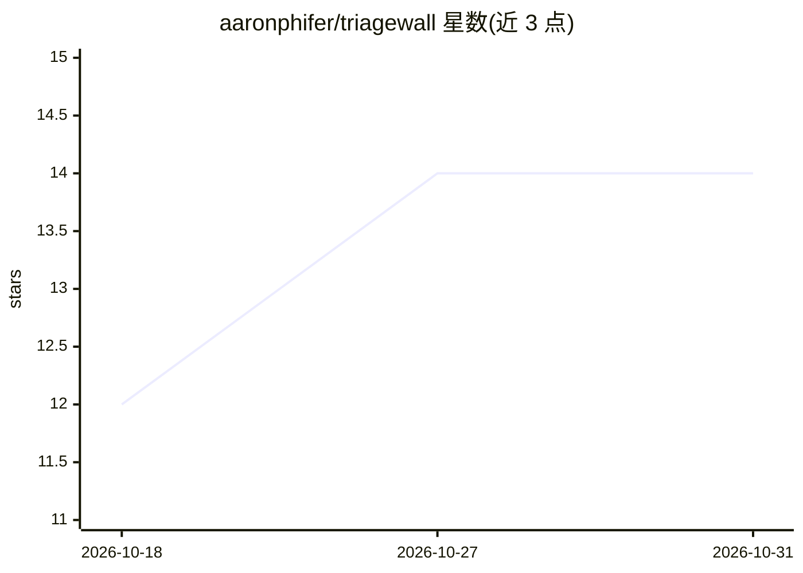

# aaronphifer/triagewall

⭐ 14 · Python · AGPL-3.0 · 推送 2026-09-25 · [GitHub](https://github.com/aaronphifer/triagewall) · [官网](https://triagewall.io) · 个人维护

**面向自托管 SOC 的本地 LLM 告警分诊工具**

读取 Suricata eve.json 与 Wazuh alerts.json，用两层机制分诊告警：确定性策略在微秒级处理已知重复噪声，剩余长尾交给本地 Ollama 模型（默认 Foundation-Sec-8B Q5_K_M）审阅，最终决策保留给分析师。提供统一审查队列、调查视图、有界搜索与带审计的版本化配置。面向自托管安全团队与 homelab 用户；只读传感器数据，不阻断流量、不做自主响应。以 Docker Compose 部署，AGPL-3.0 并提及商业许可。

## 筛选速览

| 维度 | 判定 | 备注 |
|---|---|---|
| AI 角色 | `ai-native` | 本体是模型或模型工具 |
| 许可风险 | `dual` | AGPL-3.0 |
| 部署形态 | `self-host` | docker 或自建部署 |
| 模型依赖 | local-ok | 支持本地模型 |
| 硬件要求 | — | 无带数字的原话,不猜 |
| 安装摩擦 | `low` | 无编译、无系统依赖或容器化 |
| 成熟度 | — | 结构信号不足 |

## 能力要点

- 确定性策略 + 本地 Ollama 模型的两层告警分类
- Suricata 与 Wazuh 统一审查队列，保留来源/事件/规则上下文
- 告警证据与模型推理全部留在运营者控制的硬件上
- 带乐观锁、归因与审计历史的版本化配置工作流

## 适用场景

- homelab 或小团队给 Suricata/Wazuh 高频告警做降噪分诊
- 在不出网的前提下用本地模型审阅残余告警
- 分析师在统一工作台复核告警并保留最终决策权

## 场景标签

`网络安全` · 领域:学习与行业

## 证据(README 行号)

> L26: operator with a prioritization problem. TriageWall adds a local decision layer:
> L41:  microseconds and send only the residual long tail to a local Ollama model.

## 星数曲线

2026-10-18 12 → 2026-10-31 14（+2）

---
*卡片 v1 · prompt 1.4 · 生成 2026-10-31 · 置信度 high · 依据 README sha `f0ff4b48532f` · [字段定义](../../DATASET.md)*
