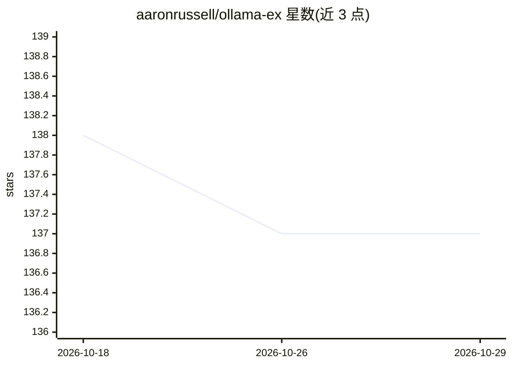

# aaronrussell/ollama-ex

⭐ 137 · Elixir · Apache-2.0 · 推送 2026-10-22 · [GitHub](https://github.com/aaronrussell/ollama-ex) · [官网](https://hexdocs.pm/ollama) · 个人维护

**Elixir 语言调用 Ollama API 的客户端库**

为 Elixir 提供与本地运行大模型的 Ollama 交互的接口，覆盖 Ollama API 的补全、聊天、结构化输出、流式请求与工具调用（function calling）。流式支持返回惰性 Enumerable 或向指定进程发送消息，适配 LiveView 场景；工具调用采用与 ChatGPT 类似的 schema 定义，需两轮请求往返并自行执行函数。以 Hex 包形式安装，要求本地已运行 Ollama。采用 Apache-2 许可。

## 筛选速览

| 维度 | 判定 | 备注 |
|---|---|---|
| AI 角色 | `ai-ecosystem` | LLM/agent 周边工具 |
| 许可风险 | `permissive` | Apache-2.0 |
| 部署形态 | `None` |  |
| 模型依赖 | local-ok | 支持本地模型 |
| 硬件要求 | — | 无带数字的原话,不猜 |
| 安装摩擦 | `low` | 无编译、无系统依赖或容器化 |
| 成熟度 | — | 结构信号不足 |

## 能力要点

- 完整实现 Ollama API（补全/聊天/结构化输出）
- 流式请求：Enumerable 或向任意 Elixir 进程发送消息
- 工具调用（function calling）与扩展思维支持
- 以 Hex 包提供，加入 mix.exs 依赖即可安装

## 适用场景

- 在 Elixir/Phoenix 应用中接入本地 Ollama 模型
- 构建流式聊天界面（如 LiveView 聊天事件）
- 让模型调用业务函数完成工具任务

## 场景标签

 · 领域:LLM 基础设施/客户端库

## 证据(README 行号)

> L9: Ollama is a powerful tool for running large language models locally or on your own infrastructure. This library prov
> L11: - 🦙 Full implementation of the Ollama API

## 星数曲线

2026-10-18 138 → 2026-10-29 137（-1）

---
*卡片 v1 · prompt 1.4 · 生成 2026-10-22 · 置信度 high · 依据 README sha `909c366cf4af` · [字段定义](../../DATASET.md)*
