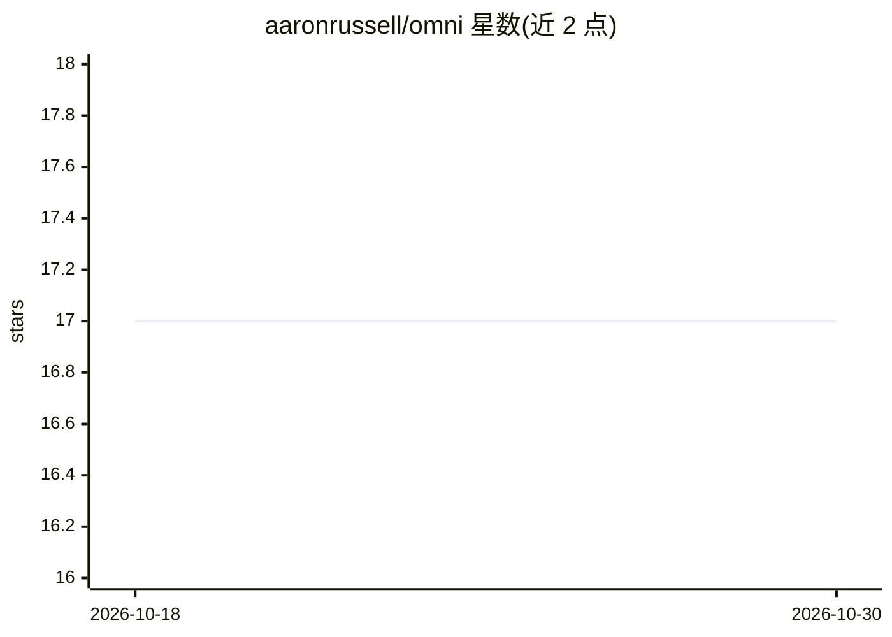

# aaronrussell/omni

⭐ 17 · Elixir · Apache-2.0 · 推送 2026-10-21 · [GitHub](https://github.com/aaronrussell/omni) · [官网](https://hexdocs.pm/omni) · 个人维护

**Elixir 的多供应商 LLM API 统一客户端库**

面向 Elixir 开发者的 LLM API 客户端库：通过统一的 generate_text/stream_text 接口访问多家 LLM 供应商（Anthropic、OpenAI、Google、Groq、OpenRouter、Ollama 等），默认流式返回；支持带 schema 的工具调用（自动执行循环并回喂结果）、JSON Schema 校验的结构化输出（含约束解码与自动重试）。模型目录默认读取内置的 models.dev 快照（无需联网），可改为启动时在线拉取或 llm_db 包。各供应商 API key 从标准环境变量读取，可实现 behaviour 扩展自定义供应商。以 Hex 包形式提供。

## 筛选速览

| 维度 | 判定 | 备注 |
|---|---|---|
| AI 角色 | `ai-ecosystem` | LLM/agent 周边工具 |
| 许可风险 | `permissive` | Apache-2.0 |
| 部署形态 | `None` |  |
| 模型依赖 | local-ok | 支持本地模型 |
| 硬件要求 | — | 无带数字的原话,不猜 |
| 安装摩擦 | `low` | 无编译、无系统依赖或容器化 |
| 成熟度 | — | 结构信号不足 |

## 能力要点

- 统一接口访问多家 LLM 供应商，含本地 Ollama 供应商（无需 API key）
- 工具调用自动执行循环与 JSON Schema 结构化输出（约束解码+重试）
- 可插拔模型目录：内置 models.dev 快照/在线拉取/llm_db 包
- 通过实现 behaviour 添加自定义供应商

## 适用场景

- 在 Elixir 应用中接入多家 LLM 供应商而无需各自对接 SDK
- 构建带工具调用与结构化输出的 LLM 应用
- 以本地 Ollama 模型为后端做离线推理

## 场景标签

`模型网关` · 领域:Agent 开发

## 证据(README 行号)

> L9: **Universal Elixir client for LLM APIs.**
> L14: - **Multi-provider** — supports many LLM providers out of the box (see table below)
> L51: A local-Ollama provider (`Omni.Providers.Ollama`) is also included; it needs

## 星数曲线

2026-10-18 17 → 2026-10-30 17（+0）

---
*卡片 v1 · prompt 1.4 · 生成 2026-10-29 · 置信度 high · 依据 README sha `569f3ea76822` · [字段定义](../../DATASET.md)*
