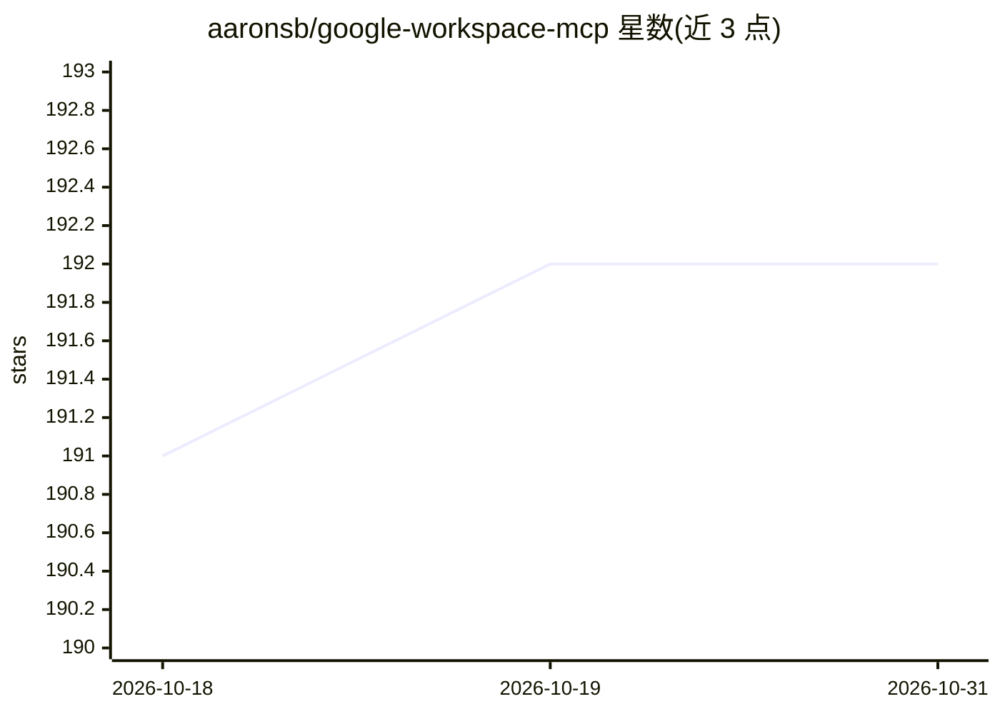

# aaronsb/google-workspace-mcp

⭐ 192 · TypeScript · Apache-2.0 · 推送 2026-10-28 · [GitHub](https://github.com/aaronsb/google-workspace-mcp) · 个人维护

**让 AI agent 经 OAuth 访问 Google Workspace 的 MCP 服务器**

以 MCP 服务器形式向 Claude Desktop、Claude Code 等 AI 客户端提供 Gmail、Calendar、Drive、Docs、Sheets、Tasks、Meet、Contacts 八项 Google 服务的认证访问，共 12 个工具、95 个操作。每账号在本机磁盘持有 OAuth token，无中间服务；支持多账号并存、按账号申请只读 scope（拒绝发生在请求发出前）、bulk_operations 串联或批量执行操作。安装需先在 Google Cloud Console 创建 OAuth 2.0 Client ID，随后可经 .mcpb 一键包、npx 或 npm 全局安装运行，要求 Node 22.12+。许可证 Apache 2.0（v3.0.0 前为 MIT）。

## 筛选速览

| 维度 | 判定 | 备注 |
|---|---|---|
| AI 角色 | `ai-ecosystem` | LLM/agent 周边工具 |
| 许可风险 | `permissive` | Apache-2.0 |
| 部署形态 | `library` | 以包/库形式分发 |
| 模型依赖 | locked-api |  |
| 硬件要求 | — | 无带数字的原话,不猜 |
| 安装摩擦 | `low` | 无编译、无系统依赖或容器化 |
| 成熟度 | — | 结构信号不足 |

## 能力要点

- 12 个工具覆盖 8 项 Google 服务，95 个操作为精选子集
- OAuth 凭据存本机，按账号管理、支持只读 scope 授权
- bulk_operations 支持 $N.field 结果引用串联与单一 Google 请求批量
- 提供 .mcpb 一键安装包，覆盖 macOS/Linux/Windows

## 适用场景

- 在 Claude Desktop/Code 中搜索邮件、查日历、写文档
- 把'找发票—归档—提醒'这类多步任务交给 agent 一次完成
- 个人与工作多个 Google 账号并行接入同一 agent

## 场景标签

 · 领域:AI 工具接入/办公自动化

## 证据(README 行号)

> L8: **Give your AI agent real access to Google Workspace** — Gmail, Calendar, Drive, Docs, Sheets, Tasks, Meet and Conta
> L25: ### 📦 → 🤖 Claude Desktop — one-click `.mcpb` install (recommended)

## 星数曲线

2026-10-18 191 → 2026-10-31 192（+1）

---
*卡片 v1 · prompt 1.4 · 生成 2026-10-22 · 置信度 high · 依据 README sha `2ece95c28256` · [字段定义](../../DATASET.md)*
