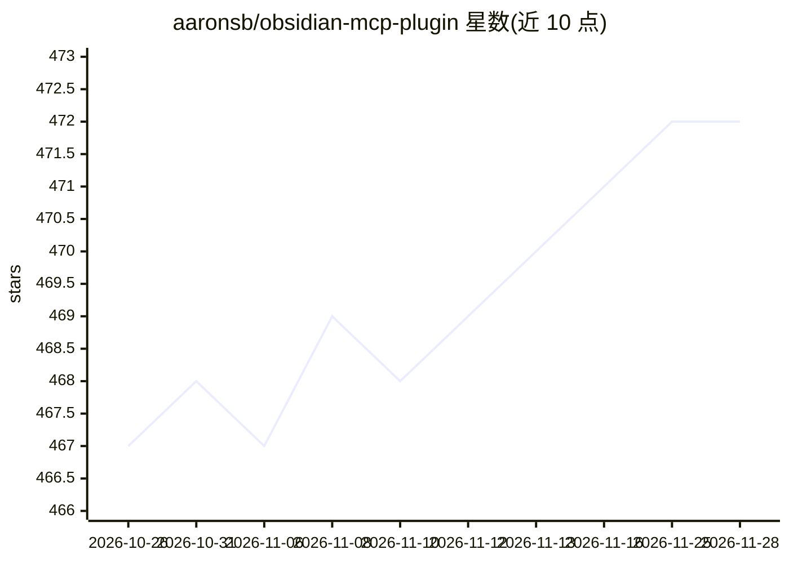

# aaronsb/obsidian-mcp-plugin

⭐ 472 · TypeScript · MIT · 推送 2026-11-15 · [GitHub](https://github.com/aaronsb/obsidian-mcp-plugin) · 个人维护

**运行在 Obsidian 内的 MCP 服务器，让 AI 助手读写检索笔记库**

以 Obsidian 插件形式内置的 MCP 服务器，无需外部 Node 进程或独立 REST 桥接插件。向任意 MCP 兼容客户端（Claude Desktop、Claude Code、Cline、Continue.dev 等）暴露 8 个工具族：文件操作、编辑、查看、链接图遍历、workflow 提示、Dataview 查询、Bases 数据库操作与系统操作。支持全文检索（tag:/path:/content: 运算符、正则、相关性排序）、多跳图谱遍历、反向链接分析与模糊文本编辑。权限机制包括只读模式、按操作控制与路径允许/阻止清单；HTTP(3001)/HTTPS(3443) 传输，API key 鉴权。

## 筛选速览

| 维度 | 判定 | 备注 |
|---|---|---|
| AI 角色 | `ai-ecosystem` | LLM/agent 周边工具 |
| 许可风险 | `permissive` | MIT |
| 部署形态 | `None` |  |
| 模型依赖 | — | README 未给出锁定关系 |
| 硬件要求 | — | 无带数字的原话,不猜 |
| 安装摩擦 | `low` | 无编译、无系统依赖或容器化 |
| 成熟度 | — | 结构信号不足 |

## 能力要点

- 服务器即插件：拖放 .mcpb 到 Claude Desktop 即完成安装
- 8 个工具族覆盖文件、编辑、图谱、Dataview、Bases 操作
- 只读模式、按操作权限控制与路径允许/阻止清单
- 多跳图谱遍历、反向/正向链接分析与路径查找

## 适用场景

- 让 AI 助手总结、检索并交叉关联我的 Obsidian 笔记
- 通过对话让 AI 创建、编辑和整理笔记
- 分析个人知识图谱中概念之间的连接

## 场景标签

`知识库管理` · 领域:知识与检索

## 证据(README 行号)

> L11: **Read, write, search, and traverse your Obsidian vault from any AI assistant — through an MCP server that runs _in
> L17: **Works with any MCP-compatible client** — Claude Desktop, Claude Code, Cline, Continue.dev, and anything that spea
> L19: > **New to MCP?** The Model Context Protocol is the open standard that lets AI assistants interact with external to

## 星数曲线

2026-10-26 467 → 2026-11-28 472（+5）

---
*卡片 v1 · prompt 1.4 · 生成 2026-11-25 · 置信度 high · 依据 README sha `dca4600a4f84` · [字段定义](../../DATASET.md)*
