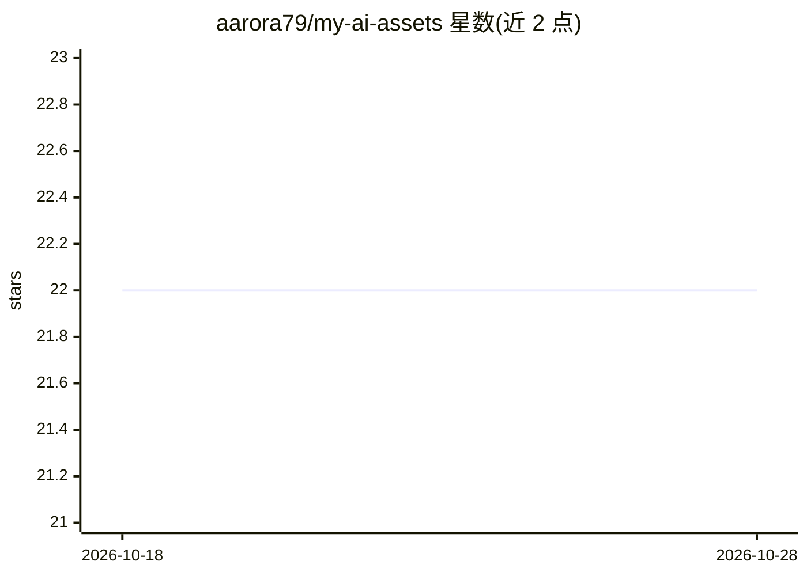

# aarora79/my-ai-assets

⭐ 22 · HTML · MIT-0 · 推送 2026-10-06 · [GitHub](https://github.com/aarora79/my-ai-assets) · 个人维护

**面向 Claude 等 LLM 的提示词模板与 Agent 技能合集**

个人维护的 AI 资产仓库，包含两类内容：prompts/ 下的复制即用提示词模板（费曼技巧的学术论文分析、Damodaran 框架的股票估值），以及 skills/ 下可供编码代理加载的 Agent Skills（写作改写、仓库转 A4 海报、技术主题 HTML 讲解页）。模板附带 generate_prompts.py 辅助脚本和示例结果。使用方式为手动复制模板、替换占位符后粘贴给 Claude、Perplexity 等模型；技能放置于 .claude/skills/ 目录加载。README 声明结果质量依赖模型、仅供教育用途、投资决策需自行核实。

## 筛选速览

| 维度 | 判定 | 备注 |
|---|---|---|
| AI 角色 | `ai-knowledge` | 知识聚合/清单类 |
| 许可风险 | `permissive` | MIT-0 |
| 部署形态 | `None` |  |
| 模型依赖 | — | README 未给出锁定关系 |
| 硬件要求 | — | 无带数字的原话,不猜 |
| 安装摩擦 | `low` | 无编译、无系统依赖或容器化 |
| 成熟度 | — | 结构信号不足 |

## 能力要点

- 费曼技巧学术论文分析模板（含 generate_prompts.py 批量生成）
- Damodaran 框架股票估值模板
- 3 个 Agent Skills：writing 改写、poster-making 海报生成、explainer 讲解页生成
- 模板遵循结构化框架、分步引导、多视角等 5 条设计原则

## 适用场景

- 用固定框架让 LLM 分析学术论文
- 按 Damodaran 方法做股票与组合估值分析
- 给 Claude Code 等代理加载写作、海报、讲解页技能

## 场景标签

`提示工程` `金融量化` · 领域:Agent 开发

## 证据(README 行号)

> L3: A collection of prompt templates and reusable skills for working with Claude and other LLMs.
> L9: - **Prompts** (`prompts/`) - copy-paste prompt templates that guide a model through a specific analytical or educati
> L10: - **Skills** (`skills/`) - reusable Agent Skills that a coding agent or assistant loads to change how it works on a

## 星数曲线

2026-10-18 22 → 2026-10-28 22（+0）

---
*卡片 v1 · prompt 1.4 · 生成 2026-10-27 · 置信度 high · 依据 README sha `64c67ae5398b` · [字段定义](../../DATASET.md)*
