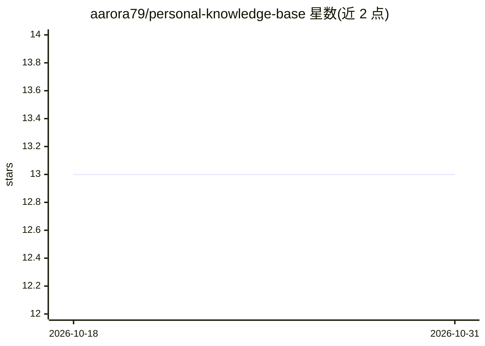

# aarora79/personal-knowledge-base

⭐ 13 · HTML · 推送 2026-09-22 · [GitHub](https://github.com/aarora79/personal-knowledge-base) · 个人维护

**LLM 维护的生成式 AI 个人知识库：源料经 Claude Code 编译为互链 wiki**

受 Karpathy LLM 知识库概念启发的个人知识库：通过 clip.sh 或 /add 命令将网页、PDF、YouTube 字幕抓取到 raw/ 目录，由 Claude Code LLM agent 读取原文、抽取关键概念、生成 200-500 字的原子化 wiki 文章与可配置深度的来源摘要，并自动建立交叉引用与知识图谱（D3.js 力导向可视化，无服务器）。不使用 RAG、向量库或嵌入，仅依赖 markdown 文件与 build_graph.py。使用者需具备 Python 3.11+、uv 包管理器与 Claude Code CLI，通过 /add、/ingest、/query、/lint 等 skill 操作。

## 筛选速览

| 维度 | 判定 | 备注 |
|---|---|---|
| AI 角色 | `ai-knowledge` | 知识聚合/清单类 |
| 许可风险 | `none` | — |
| 部署形态 | `None` |  |
| 模型依赖 | locked-api |  |
| 硬件要求 | — | 无带数字的原话,不猜 |
| 安装摩擦 | `low` | 无编译、无系统依赖或容器化 |
| 成熟度 | — | 结构信号不足 |

## 能力要点

- 四层输出体系：Clip（存档）、Wiki（原子文章）、Analysis（费曼式分析）、Explainer（可发布 HTML）
- 知识图谱含三种边类型，D3.js 自包含交互可视化，每次摄取后自动重建
- 无 RAG/向量库/嵌入，纯 markdown + 知识图谱 + LLM 充当图书管理员
- 来源摘要深度可配置（Feynman/大学/专家三级）

## 适用场景

- 把网页、论文、视频资料整理成互链的个人生成式 AI 知识库
- 通过知识图谱浏览跨来源概念关联
- 用 /query 按标签和关键词检索并合成带引用的回答

## 场景标签

`知识库管理` `知识图谱` · 领域:知识与检索

## 证据(README 行号)

> L3: An LLM-maintained knowledge base for Generative AI topics. Inspired by Andrej Karpathy's LLM Knowledge Bases concept
> L5: No RAG. No vector databases. No embeddings. Just markdown files, a knowledge graph, and an LLM acting as librarian.
> L48: |Wiki|`wiki/<slug>/`|Atomic articles, 200-500 words each, tagged and cross-linked into the graph.|A few minutes, `/

## 星数曲线

2026-10-18 13 → 2026-10-31 13（+0）

---
*卡片 v1 · prompt 1.4 · 生成 2026-10-31 · 置信度 high · 依据 README sha `aae89b729972` · [字段定义](../../DATASET.md)*
