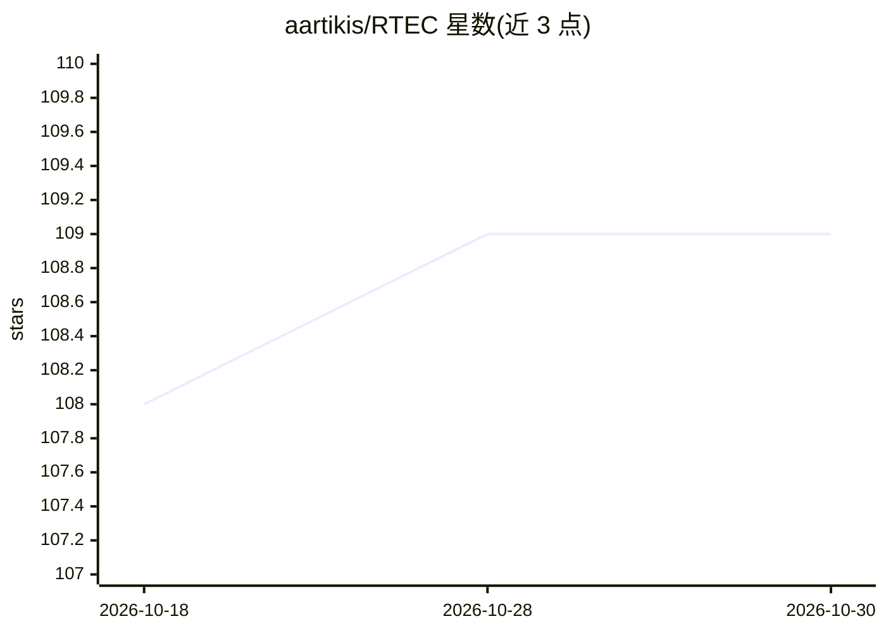

# aartikis/RTEC

⭐ 109 · Prolog · LGPL-3.0 · 推送 2026-10-26 · [GitHub](https://github.com/aartikis/RTEC) · 组织维护

**面向数据流的 Event Calculus 逻辑编程系统（流推理）**

RTEC 是开源的 Event Calculus 方言，使用 Prolog 编写，针对数据流上的复杂事件识别与流推理场景优化，已在 SWI-Prolog 下于 Linux、MacOS 与 Windows 测试。README 提供许可证（LGPL v3）与文档链接，并列出相关软件：支持增量推理的 iRTEC、面向不确定性流数据的 oPIEC、基于符号自动机与马尔可夫模型的 Wayeb。README 未包含安装命令或使用示例。

## 筛选速览

| 维度 | 判定 | 备注 |
|---|---|---|
| AI 角色 | `ai-ecosystem` | LLM/agent 周边工具 |
| 许可风险 | `viral` | LGPL-3.0 |
| 部署形态 | `None` |  |
| 模型依赖 | — | README 未给出锁定关系 |
| 硬件要求 | — | 无带数字的原话,不猜 |
| 安装摩擦 | `low` | 无编译、无系统依赖或容器化 |
| 成熟度 | — | 结构信号不足 |

## 能力要点

- Event Calculus 方言，面向数据流推理优化
- 以 Prolog 实现，在 SWI-Prolog 下测试
- 支持 Linux、MacOS、Windows 三个平台测试
- LGPL v3 许可的开源软件

## 适用场景

- 在数据流上做复杂事件识别与流推理
- 用 Event Calculus 形式化方法做时序事件推理研究
- 作为复杂事件处理（CEP）研究的基础实现

## 场景标签

 · 领域:复杂事件处理/流推理

## 证据(README 行号)

> L3: RTEC is an open-source Event Calculus dialect optimised for data stream reasoning. It is written in Prolog and has b
> L16: - iRTEC: Incremental RTEC. iRTEC supports incremental reasoning, handling efficiently the delays and retractions in

## 星数曲线

2026-10-18 108 → 2026-10-30 109（+1）

---
*卡片 v1 · prompt 1.4 · 生成 2026-10-23 · 置信度 high · 依据 README sha `98d8eec8d4b7` · [字段定义](../../DATASET.md)*
