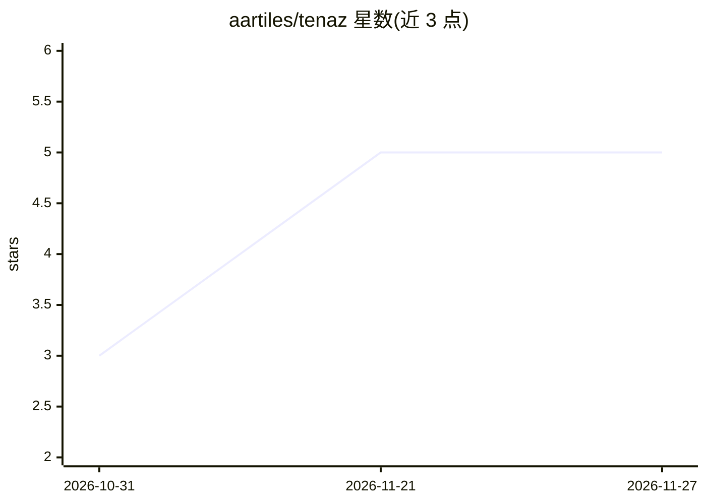

# aartiles/tenaz

⭐ 5 · Rust · Apache-2.0 · 推送 2026-11-25 · [GitHub](https://github.com/aartiles/tenaz) · 个人维护

**让本地 LLM 经编码代理长时间自主构建软件的运行器**

Tenaz 是一个 Rust 编写的 CLI 运行器：将目标简报转为编号需求、verify 校验脚本与任务卡，逐任务以全新会话驱动编码代理（fx/Pi/OpenCode/Qwen Code 等 ACP 代理）构建，verify 通过并经审查才提交，失败则回退重试、拆分或阻塞。面向一次只能载入一个模型的单机（笔记本/单 GPU）本地环境，内置引擎崩溃重试、上下文看门狗、图像模型与 LLM 的显存换载、暂停续跑。默认不沙箱代理，需 git。

## 筛选速览

| 维度 | 判定 | 备注 |
|---|---|---|
| AI 角色 | `ai-ecosystem` | LLM/agent 周边工具 |
| 许可风险 | `permissive` | Apache-2.0 |
| 部署形态 | `desktop` | 安装包/桌面程序 |
| 模型依赖 | local-ok | 支持本地模型 |
| 硬件要求 | — | 无带数字的原话,不猜 |
| 安装摩擦 | `low` | 无编译、无系统依赖或容器化 |
| 成熟度 | — | 结构信号不足 |

## 能力要点

- verify 脚本判定完成与否，模型自述不计入
- 每任务全新会话、状态落盘、每步 git 提交
- 引擎故障退避重试，不计为任务失败
- 图像/LLM 模型按需卸载重载（--model-for/--swap-models）

## 适用场景

- 在单卡/笔记本上让本地模型连续数小时自主完成可验证的构建目标
- 让 Claude Code/Codex 把长目标委托给本地模型执行并事后验收
- 在已有项目中以 verify 包装现有测试做增量任务构建

## 场景标签

`编码 Agent` · 领域:编码与开发

## 证据(README 行号)

> L3: Tenaz drives a local model through a coding agent until the goal passes its
> L127: - **Engine**: the server that runs the model and answers OpenAI-compatible
> L130: - **Harness**: the coding agent Tenaz drives in each session: fx, Pi,

## 星数曲线

2026-10-31 3 → 2026-11-27 5（+2）

---
*卡片 v1 · prompt 1.4 · 生成 2026-11-21 · 置信度 mid · 依据 README sha `a562aa6bec06` · [字段定义](../../DATASET.md)*
