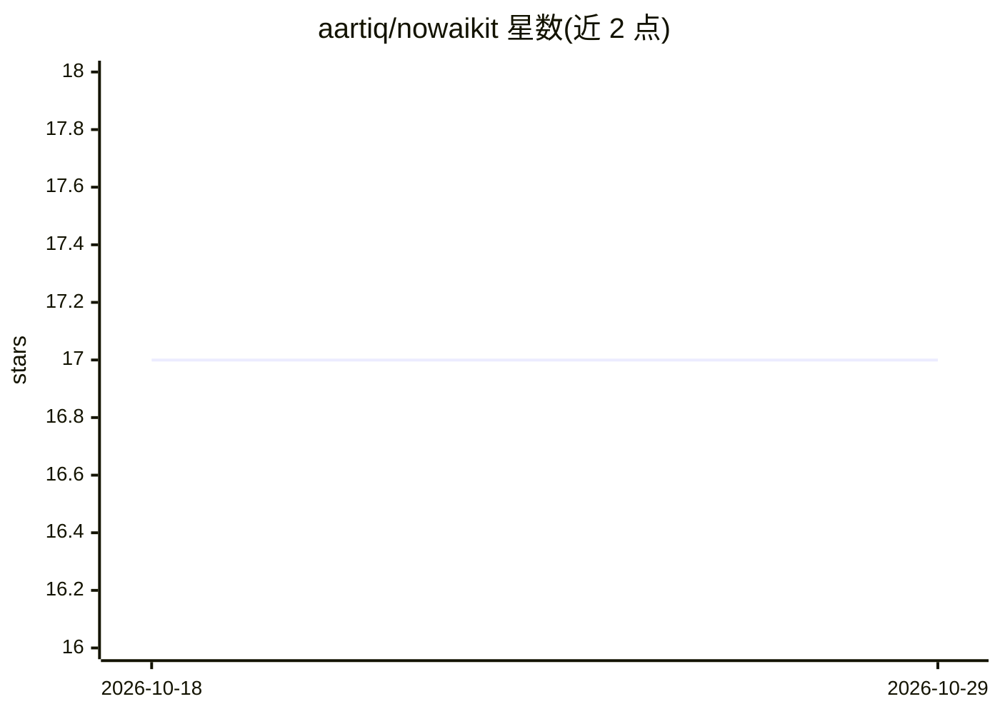

# aartiq/nowaikit

⭐ 17 · TypeScript · NOASSERTION · 推送 2026-09-23 · [GitHub](https://github.com/aartiq/nowaikit) · [官网](https://nowaikit.com) · 组织维护

**连接 AI 客户端与 ServiceNow 的 MCP 服务器（500+ 工具）**

面向 ServiceNow 用户与开发者的 MCP server：提供 500+ 覆盖 ITSM、ITOM、CMDB、HRSD、CSM、Flow Designer 等领域的工具，让 Claude、ChatGPT、Cursor、Copilot 等 AI 客户端以自然语言读取、查询与自动化 ServiceNow 实例。支持 stdio/SSE/HTTP 多传输与按需工具发现以控制 token 成本；默认只读，写入与脚本变更需显式开启。通过 npm 全局安装并用向导完成 OAuth 配置，也可运行本地 Web 仪表盘。源码依 Elastic License 2.0 提供，托管/转售需商业协议。

## 筛选速览

| 维度 | 判定 | 备注 |
|---|---|---|
| AI 角色 | `ai-ecosystem` | LLM/agent 周边工具 |
| 许可风险 | `none` | NOASSERTION |
| 部署形态 | `desktop` | 安装包/桌面程序 |
| 模型依赖 | locked-api |  |
| 硬件要求 | — | 无带数字的原话,不猜 |
| 安装摩擦 | `low` | 无编译、无系统依赖或容器化 |
| 成熟度 | — | 结构信号不足 |

## 能力要点

- 500+ ServiceNow 工具，含影响分析与本地同步（4.4-4.7 新增）
- 多传输（stdio/SSE/HTTP）与按需工具发现，控制 token 成本
- 默认只读，写入/脚本/CMDB 变更为可选开启
- 安装向导自动完成 OAuth（含 PKCE）并写入客户端配置

## 适用场景

- 用自然语言查询和操作 ServiceNow 工单、变更与 CMDB
- 让 AI 助手创建业务规则或运行 ATF 测试套件
- 修改表/字段/脚本前查看依赖影响分析

## 场景标签

`工作流自动化` · 领域:效率与自动化

## 证据(README 行号)

> L10: **Connect Claude, ChatGPT, Gemini, Cursor, Copilot, or any AI, to ServiceNow.**
> L12: 500+ tools across ITSM, ITOM, CMDB, HRSD, CSM, Flow Designer, scripting & portal. Read, build, query and automate a

## 星数曲线

2026-10-18 17 → 2026-10-29 17（+0）

---
*卡片 v1 · prompt 1.4 · 生成 2026-10-29 · 置信度 high · 依据 README sha `355611348c66` · [字段定义](../../DATASET.md)*
