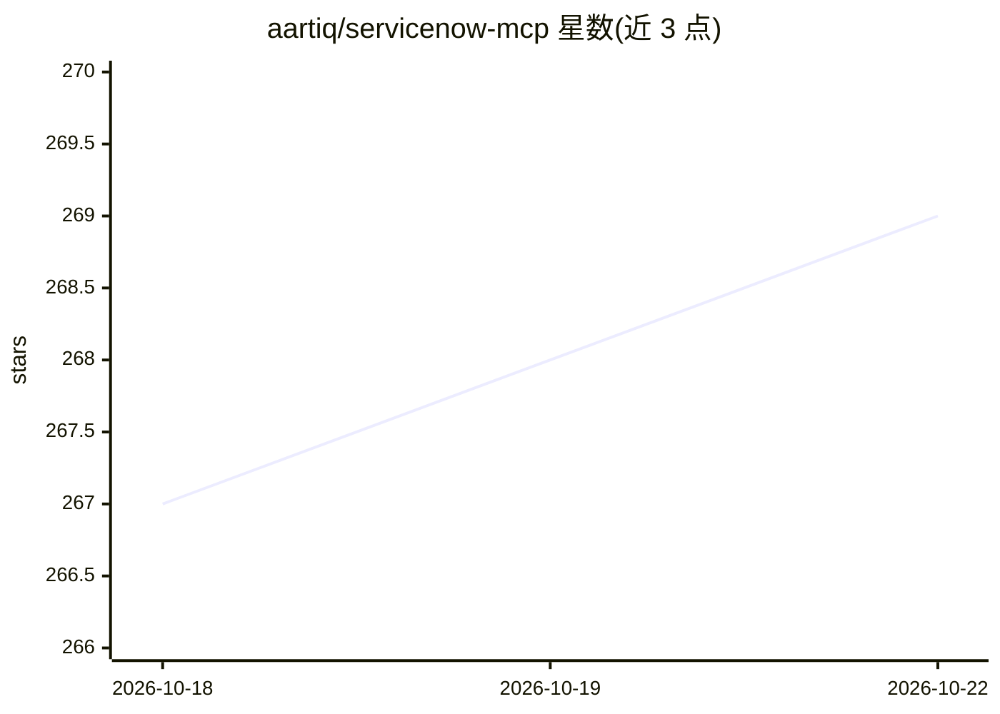

# aartiq/servicenow-mcp

⭐ 269 · TypeScript · NOASSERTION · 推送 2026-09-23 · [GitHub](https://github.com/aartiq/servicenow-mcp) · [官网](https://servicenow-mcp.com) · 组织维护

**把 Claude/ChatGPT/Cursor 等 AI 客户端接入 ServiceNow 的 MCP 服务器**

ServiceNow MCP 服务器，向 Claude、ChatGPT、Gemini、Cursor、Copilot 等 AI 客户端提供 500+ 工具，覆盖 ITSM、ITOM、CMDB、HRSD、CSM、Flow Designer、脚本与门户，用自然语言读取、构建、查询和自动化 ServiceNow 实例。默认只读，写入/脚本/CMDB 变更为可选开启的标志。通过 npm 全局安装并用 npx 向导写入各 AI 客户端的 MCP 配置；需 Node.js 20+；支持多实例与 OAuth，另有无需安装的 NowAIKit Cloud。源码以 Elastic License 2.0 提供。

## 筛选速览

| 维度 | 判定 | 备注 |
|---|---|---|
| AI 角色 | `ai-ecosystem` | LLM/agent 周边工具 |
| 许可风险 | `none` | NOASSERTION |
| 部署形态 | `desktop` | 安装包/桌面程序 |
| 模型依赖 | — | README 未给出锁定关系 |
| 硬件要求 | — | 无带数字的原话,不猜 |
| 安装摩擦 | `low` | 无编译、无系统依赖或容器化 |
| 成熟度 | — | 结构信号不足 |

## 能力要点

- 500+ 工具覆盖 ITSM/ITOM/CMDB/HRSD/CSM 等领域
- 默认只读，写操作与脚本变更按 opt-in 标志开启
- npx 向导自动检测 AI 客户端并写入 MCP 配置
- 影响分析（表/字段/脚本依赖查找）与本地同步功能

## 适用场景

- 让 Claude/Cursor 等客户端直接查询和操作 ServiceNow 实例
- 用自然语言创建业务规则、跑 ATF 测试套件
- 改动表或脚本前先查看依赖项做影响分析

## 场景标签

`工作流自动化` · 领域:效率与自动化

## 证据(README 行号)

> L10: **Connect Claude, ChatGPT, Gemini, Cursor, Copilot, or any AI, to ServiceNow.**
> L12: 500+ tools across ITSM, ITOM, CMDB, HRSD, CSM, Flow Designer, scripting & portal. Read, build, query and automate a

## 星数曲线

2026-10-18 267 → 2026-10-22 269（+2）

---
*卡片 v1 · prompt 1.4 · 生成 2026-10-22 · 置信度 high · 依据 README sha `3c1c8fbbe07a` · [字段定义](../../DATASET.md)*
