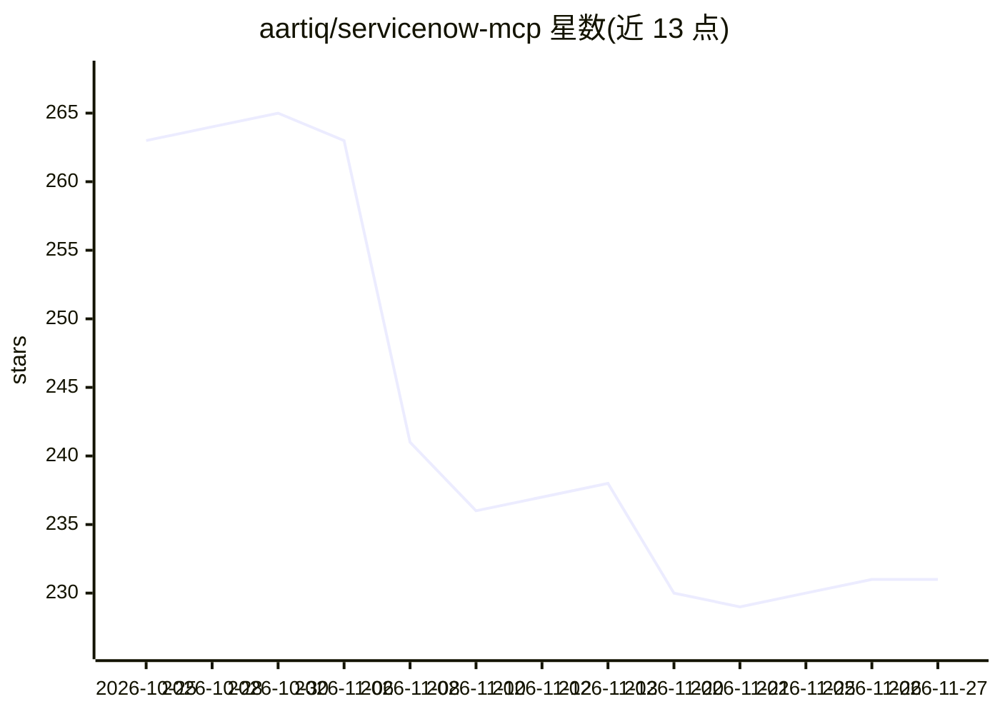

# aartiq/servicenow-mcp

⭐ 231 · TypeScript · NOASSERTION · 推送 2026-11-21 · [GitHub](https://github.com/aartiq/servicenow-mcp) · [官网](https://nowaikit.com) · 组织维护

**把 Claude/ChatGPT 等 AI 接入 ServiceNow 实例的 MCP 服务器**

提供 MCP 服务器，将 Claude、ChatGPT、Gemini、Cursor、Copilot 等 AI 客户端连接到 ServiceNow 实例，覆盖 ITSM、ITOM、CMDB、HRSD、CSM、Flow Designer 等领域的 500+ 工具。支持 stdio/SSE/HTTP 多种传输与 OAuth 多实例，默认只读，写入与脚本操作需显式开启。通过 npm 全局安装，提供配置向导自动写入各客户端 MCP 配置，另有本地 Web 控制台与 NowAIKit Cloud 托管形态。

## 筛选速览

| 维度 | 判定 | 备注 |
|---|---|---|
| AI 角色 | `ai-ecosystem` | LLM/agent 周边工具 |
| 许可风险 | `none` | NOASSERTION |
| 部署形态 | `desktop` | 安装包/桌面程序 |
| 模型依赖 | — | README 未给出锁定关系 |
| 硬件要求 | — | 无带数字的原话,不猜 |
| 安装摩擦 | `low` | 无编译、无系统依赖或容器化 |
| 成熟度 | — | 结构信号不足 |

## 能力要点

- 500+ ServiceNow 工具，覆盖 ITSM/ITOM/CMDB/HRSD/CSM 等
- 配置向导自动检测 AI 客户端并写入 MCP 配置
- 默认只读，写入与 CMDB 变更为 opt-in 开关
- 多传输（stdio/SSE/HTTP）、OAuth 与多实例支持

## 适用场景

- 用自然语言查询和管理 ServiceNow 工单、变更与 CMDB
- 在 Claude Desktop 或 Cursor 中直接操作 ServiceNow 表单与审批
- 为 IT 运维团队搭建 AI 到 ServiceNow 的自动化通道

## 场景标签

`工作流自动化` · 领域:效率与自动化

## 证据(README 行号)

> L10: **Connect Claude, ChatGPT, Gemini, Cursor, Copilot, or any AI, to ServiceNow.**
> L18: > Requires **Node.js 20+**.
> L22: npm install -g nowaikit

## 星数曲线

2026-10-25 263 → 2026-11-27 231（-32）

---
*卡片 v1 · prompt 1.4 · 生成 2026-11-25 · 置信度 high · 依据 README sha `daed6a89492c` · [字段定义](../../DATASET.md)*
