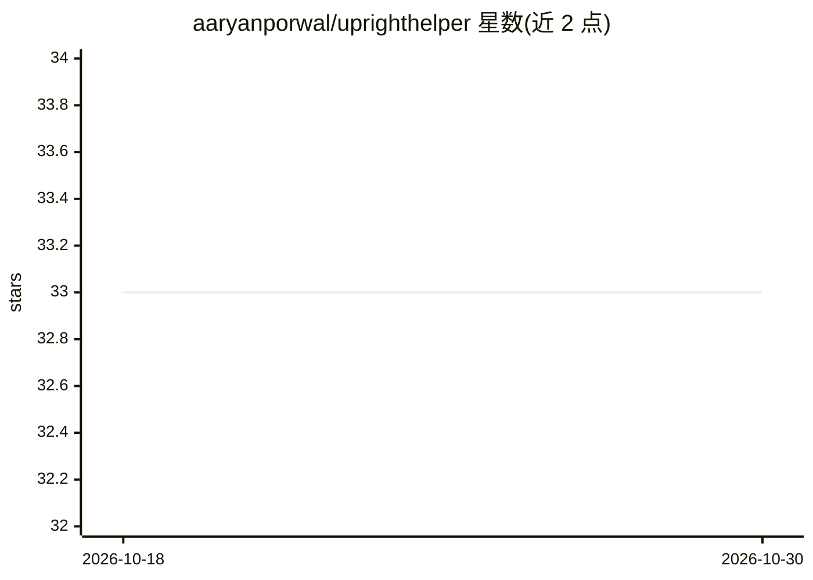

# aaryanporwal/uprighthelper

⭐ 33 · TypeScript · MIT · 推送 2026-08-24 · [GitHub](https://github.com/aaryanporwal/uprighthelper) · [官网](https://aaryanporwal.github.io/uprighthelper/) · 个人维护

**浏览器端坐姿监测网页：姿势估计识别驼背并提醒**

纯前端网页应用，通过摄像头采集画面并用 MoveNet Lightning（TensorFlow.js）做设备端姿势估计。用户先分别采集正确与错误坐姿各约 15 帧完成校准，随后页面持续监测，检测到驼背时以背景变色和声音提醒。校准数据存于浏览器 IndexedDB，无需每次刷新重新校准；所有处理在本地进行，不上传视频帧。技术栈为 Vite + TypeScript + Bun，本地开发需安装 Bun。

## 筛选速览

| 维度 | 判定 | 备注 |
|---|---|---|
| AI 角色 | `ai-native` | 本体是模型或模型工具 |
| 许可风险 | `permissive` | MIT |
| 部署形态 | `None` |  |
| 模型依赖 | — | README 未给出锁定关系 |
| 硬件要求 | — | 无带数字的原话,不猜 |
| 安装摩擦 | `low` | 无编译、无系统依赖或容器化 |
| 成熟度 | — | 结构信号不足 |

## 能力要点

- MoveNet Lightning（TensorFlow.js）设备端实时姿势检测
- 正确/错误姿势各采集约 15 帧完成个性化校准，存于 IndexedDB
- 驼背时以背景变色和声音提醒
- 全部处理在浏览器本地，不上传视频帧

## 适用场景

- 长时间伏案工作的人在浏览器里监测坐姿
- 校准个人正确姿势基线并获得驼背提醒
- 无需安装软件、不想上传摄像头数据的姿势监测

## 场景标签

`目标检测` · 领域:感知与多模态

## 证据(README 行号)

> L3: A browser-based posture monitor that uses on-device pose estimation to warn you when you slouch. Everything runs loc
> L18: - **MoveNet Lightning** via TensorFlow.js for real-time pose detection

## 星数曲线

2026-10-18 33 → 2026-10-30 33（+0）

---
*卡片 v1 · prompt 1.4 · 生成 2026-10-25 · 置信度 high · 依据 README sha `5abac62067c3` · [字段定义](../../DATASET.md)*
