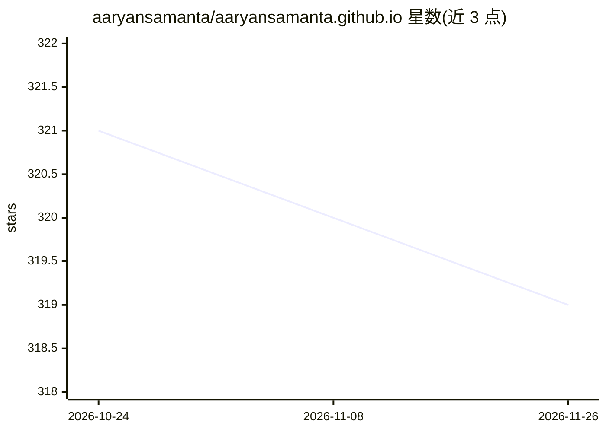

# aaryansamanta/aaryansamanta.github.io

⭐ 319 · HTML · NOASSERTION · 推送 2026-11-25 · [GitHub](https://github.com/aaryansamanta/aaryansamanta.github.io) · 个人维护

**AI/计算生物研究者 Aaryan Samanta 的个人静态主页与研究作品集**

单文件 index.html 构建的 GitHub Pages 用户站点，汇总研究论文、竞赛成绩、组织经历与学术记录，每项数据附公开来源链接；内含 11 个交互式研究演示页（胸片分类、细胞追踪、糖尿病预测、RNA 折叠等）。无构建步骤、无框架、无第三方请求，支持明暗主题与无 JavaScript 浏览；仓库带 Python 检查脚本校验链接与数据一致性，并提供脚本重建简历 PDF 与 README 动图。内容与代码分许可：代码 MIT，文字与个人信息保留所有权利。

## 筛选速览

| 维度 | 判定 | 备注 |
|---|---|---|
| AI 角色 | `ai-enhanced` | 去掉 AI 部分产品仍成立 |
| 许可风险 | `none` | NOASSERTION |
| 部署形态 | `library` | 以包/库形式分发 |
| 模型依赖 | — | README 未给出锁定关系 |
| 硬件要求 | — | 无带数字的原话,不猜 |
| 安装摩擦 | `low` | 无编译、无系统依赖或容器化 |
| 成熟度 | — | 结构信号不足 |

## 能力要点

- 单文件静态站：无构建步骤、无框架、无跟踪器、无第三方请求
- 11 个交互式研究演示页，配导航与对比入口
- tools/check.py 在提交前校验失效链接、电话号码与占位文本
- 脚本化重建简历 PDF 与 72 帧 README 动图

## 适用场景

- 查阅该研究者的论文、竞赛与项目记录并核验来源
- 浏览交互式机器学习与计算生物研究演示
- 参考其单文件静态个人站的组织方式

## 场景标签

 · 领域:个人网站/作品集

## 证据(README 行号)

> L16: **Personal site of Aaryan Samanta: research, competitions, and the organizations I run.**
> L51: - 🪶 **No build step, no framework, no trackers, no third-party requests.** Fonts are self-hosted.
> L140: This repository is a GitHub Pages **user site**, so it must be named exactly `aaryansamanta.github.io`.

## 星数曲线

2026-10-24 321 → 2026-11-26 319（-2）

---
*卡片 v1 · prompt 1.4 · 生成 2026-11-25 · 置信度 mid · 依据 README sha `c9bc33805db0` · [字段定义](../../DATASET.md)*
