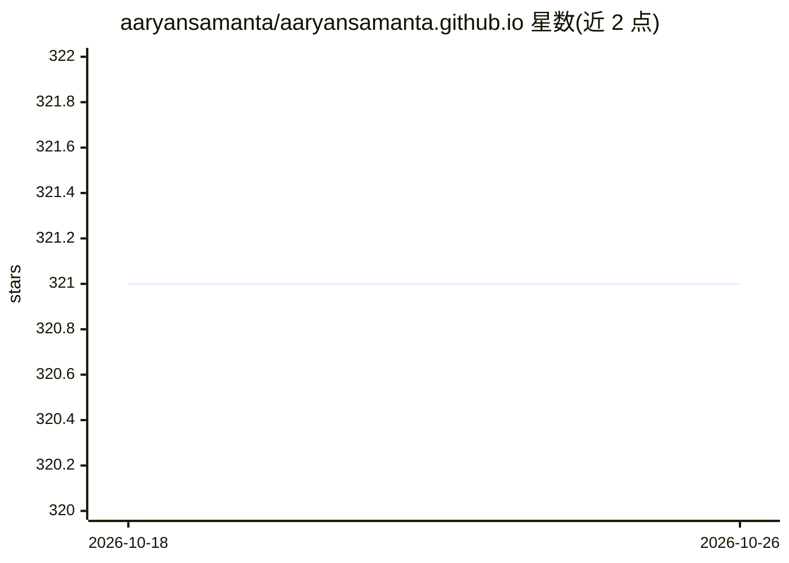

# aaryansamanta/aaryansamanta.github.io

⭐ 321 · HTML · NOASSERTION · 推送 2026-10-24 · [GitHub](https://github.com/aaryansamanta/aaryansamanta.github.io) · 个人维护

**机器学习研究者的个人静态作品集网站（GitHub Pages）**

单页静态个人网站，展示 Aaryan Samanta 的机器学习（生物与医学方向）研究论文、竞赛成绩与所运营组织。无构建步骤、无框架、无第三方请求，禁 JS 也可用；内容全部写在 index.html，配 tools/check.py 做链接与占位文本校验，另有脚本重建简历 PDF 与横幅 GIF，通过 GitHub Pages 用户站点部署。仅内容为静态展示，不含可运行的 AI 功能。

## 筛选速览

| 维度 | 判定 | 备注 |
|---|---|---|
| AI 角色 | `ai-knowledge` | 知识聚合/清单类 |
| 许可风险 | `none` | NOASSERTION |
| 部署形态 | `library` | 以包/库形式分发 |
| 模型依赖 | — | README 未给出锁定关系 |
| 硬件要求 | — | 无带数字的原话,不猜 |
| 安装摩擦 | `low` | 无编译、无系统依赖或容器化 |
| 成熟度 | — | 结构信号不足 |

## 能力要点

- 单文件静态页，无构建步骤、无追踪器、字体自托管
- tools/check.py 在提交前校验链接、联系方式与占位文本
- 脚本化重建简历 PDF 与 72 帧横幅 GIF
- 支持无 JavaScript 浏览与打印、深浅主题

## 适用场景

- 作为研究者个人主页展示论文、竞赛与项目记录
- 通过 GitHub Pages 分支部署自动上线
- 按内容指南维护可溯源的成果记录

## 场景标签

 · 领域:个人网站/学术展示

## 证据(README 行号)

> L16: **Personal site of Aaryan Samanta: research, competitions, and the organizations I run.**
> L35: |🔬|**Research**|Papers with a copy-BibTeX button, mentored research, projects|

## 星数曲线

2026-10-18 321 → 2026-10-26 321（+0）

---
*卡片 v1 · prompt 1.4 · 生成 2026-10-21 · 置信度 low · 依据 README sha `297e845b1854` · [字段定义](../../DATASET.md)*
