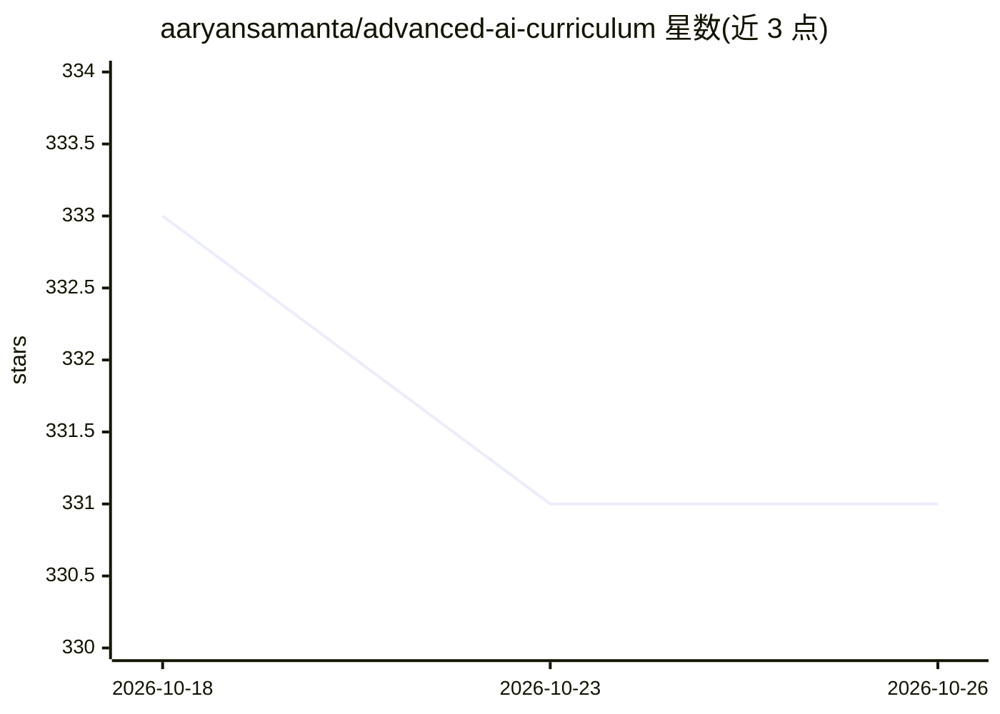

# aaryansamanta/advanced-ai-curriculum

⭐ 331 · Jupyter Notebook · 推送 2026-09-20 · [GitHub](https://github.com/aaryansamanta/advanced-ai-curriculum) · [官网](https://aaryansamanta.github.io/) · 个人维护

**个人 AI/数据科学课程与顶点项目作品集合**

Aaryan Samanta 的个人课程与顶点项目作品集，汇集五个荣誉项目的成果：监督学习与 CNN 胸片肺炎检测、医疗数据探索性分析、糖尿病风险预测 ML 流水线、NLP 情感分析及 AI 伦理研究报告。代码以 .ipynb/.py 形式存放，各文件夹含 README 说明数据集与要点。仓库声明内容未发表、限制复制与再分发，以保护学术诚信与后续发表机会。

## 筛选速览

| 维度 | 判定 | 备注 |
|---|---|---|
| AI 角色 | `ai-knowledge` | 知识聚合/清单类 |
| 许可风险 | `none` | — |
| 部署形态 | `None` |  |
| 模型依赖 | — | README 未给出锁定关系 |
| 硬件要求 | — | 无带数字的原话,不猜 |
| 安装摩擦 | `low` | 无编译、无系统依赖或容器化 |
| 成熟度 | — | 结构信号不足 |

## 能力要点

- CNN 胸片肺炎检测顶点项目（含技术报告与幻灯片）
- 糖尿病风险预测端到端 ML 流水线（含讲解视频）
- 医疗数据集 EDA 项目（清洗/特征探索/相关性分析）
- AI 伦理与社会影响研究顶点项目

## 适用场景

- 浏览个人 AI/数据科学学习路径与项目成果
- 参考医疗影像 CNN 与 ML 流水线的项目组织方式（受使用限制约束）

## 场景标签

`教程课程` · 领域:学习与行业

## 证据(README 行号)

> L14: Welcome to my portfolio of **Capstone projects and coursework** from a series of advanced AI and Data Science progr
> L27: ├── ai-internship-honors/        🤖 Supervised learning → CNNs → medical imaging capstone
> L31: └── machine_learning_honors/     ⚙️ Diabetes prediction capstone (ML pipeline + video)

## 星数曲线

2026-10-18 333 → 2026-10-26 331（-2）

---
*卡片 v1 · prompt 1.4 · 生成 2026-10-22 · 置信度 mid · 依据 README sha `b56e24b1063c` · [字段定义](../../DATASET.md)*
