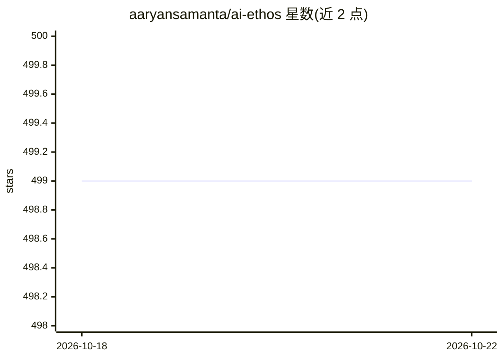

# aaryansamanta/ai-ethos

⭐ 498 · PHP · 推送 2026-09-20 · [GitHub](https://github.com/aaryansamanta/ai-ethos) · [官网](https://www.aiethos.org) · 组织维护

**非营利组织官网源码：面向弱势学习者的多语言 AI 辅导**

AI Ethos, Inc. 是 501(c)(3) 非营利组织，本仓库为其官网 aiethos.org 的源码。组织使命为向低收入、农村、多语言及神经多样性学生提供伦理、包容、多语言的 AI 辅导：支持 7 种语言、离线与低连通环境、隐私优先且不商业化学生数据。README 披露运营数据（1,500+ 学生、75% 来自弱势社区）、董事会与顾问名单、合作伙伴及捐赠/志愿者/合作渠道，并给出 2025-2026 里程碑与 2030 愿景。

## 筛选速览

| 维度 | 判定 | 备注 |
|---|---|---|
| AI 角色 | `ai-native` | 本体是模型或模型工具 |
| 许可风险 | `none` | — |
| 部署形态 | `None` |  |
| 模型依赖 | — | README 未给出锁定关系 |
| 硬件要求 | — | 无带数字的原话,不猜 |
| 安装摩擦 | `low` | 无编译、无系统依赖或容器化 |
| 成熟度 | — | 结构信号不足 |

## 能力要点

- 面向弱势学习者（低收入/农村/多语言/神经多样性）的 AI 辅导服务
- 7 种语言支持，离线与低连通环境可用
- 隐私优先设计：学生数据不被商业化
- 1,500+ 学生覆盖，75% 来自弱势社区

## 适用场景

- 了解或支持面向弱势群体的 AI 教育公益项目
- 通过捐赠、志愿服务或机构合作参与
- 获取组织官网源码用于查看或协作

## 场景标签

 · 领域:教育科技/公益

## 证据(README 行号)

> L6: A 501(c)(3) nonprofit dedicated to ethical, inclusive, multilingual AI tutoring for underserved learners worldwide.
> L19: AI Ethos is a **501(c)(3) nonprofit organization** dedicated to transforming global education through **ethical, in
> L40: - **Localized, Learner-Centered Tutoring** — personalized academic support built for low-income and rural learners,

## 星数曲线

2026-10-18 499 → 2026-10-22 499（+0）

---
*卡片 v1 · prompt 1.4 · 生成 2026-10-21 · 置信度 mid · 依据 README sha `9a4bc78357b9` · [字段定义](../../DATASET.md)*
