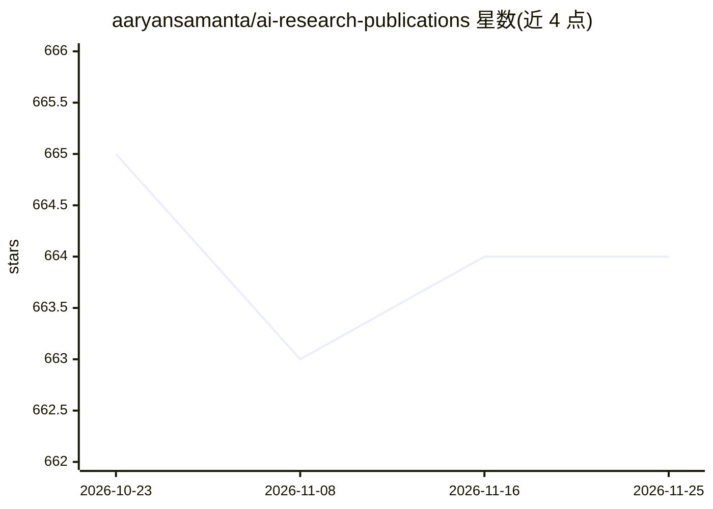

# aaryansamanta/ai-research-publications

⭐ 664 · HTML · 推送 2026-11-20 · [GitHub](https://github.com/aaryansamanta/ai-research-publications) · [官网](https://aaryansamanta.github.io/) · 个人维护

**高中生的计算研究作品集：14个项目+论文集展示**

一名11年级学生的计算研究作品集，收录14个项目：2篇同行评审论文（IEEE AIAM、IJHSR）与涵盖量子启发式机器学习、计算生物学、生物医学成像、野火强化学习、科学教育的研究项目。每个条目提供在线演示与源码链接，并附研究归属说明：区分团队与个人贡献、标注未完成的实验计划、声明动画为装饰性内容而非实验数据。

## 筛选速览

| 维度 | 判定 | 备注 |
|---|---|---|
| AI 角色 | `ai-knowledge` | 知识聚合/清单类 |
| 许可风险 | `none` | — |
| 部署形态 | `None` |  |
| 模型依赖 | — | README 未给出锁定关系 |
| 硬件要求 | — | 无带数字的原话,不猜 |
| 安装摩擦 | `low` | 无编译、无系统依赖或容器化 |
| 成熟度 | `idea` | |

## 能力要点

- 14 个项目按演示优先顺序编排，每项含 demo 与源码入口
- 包含 QIHGA–GNN 可执行源码、测试与论文手稿
- 归属说明区分 implemented/preliminary/planned 状态

## 适用场景

- 浏览量子启发式特征搜索与图神经网络结合的演示
- 查看 C. elegans 群体基因组学与表达建模研究
- 了解面向教育公平的 AI 学习平台项目

## 场景标签

 · 领域:科研作品集/学术展示

## 证据(README 行号)

> L1: Animated scientific research portfolio — computational biology, AI systems, and social impact
> L6: *An 11th-grade student's collection of computational research, interactive scientific prototypes, and educational te
> L16: **14 projects · One directory · One click to a demo, one click to code.** Ordered for an admissions reviewer: compe

## 星数曲线

2026-10-23 665 → 2026-11-25 664（-1）

---
*卡片 v1 · prompt 1.4 · 生成 2026-11-24 · 置信度 high · 依据 README sha `e34cd2e2e05d` · [字段定义](../../DATASET.md)*
