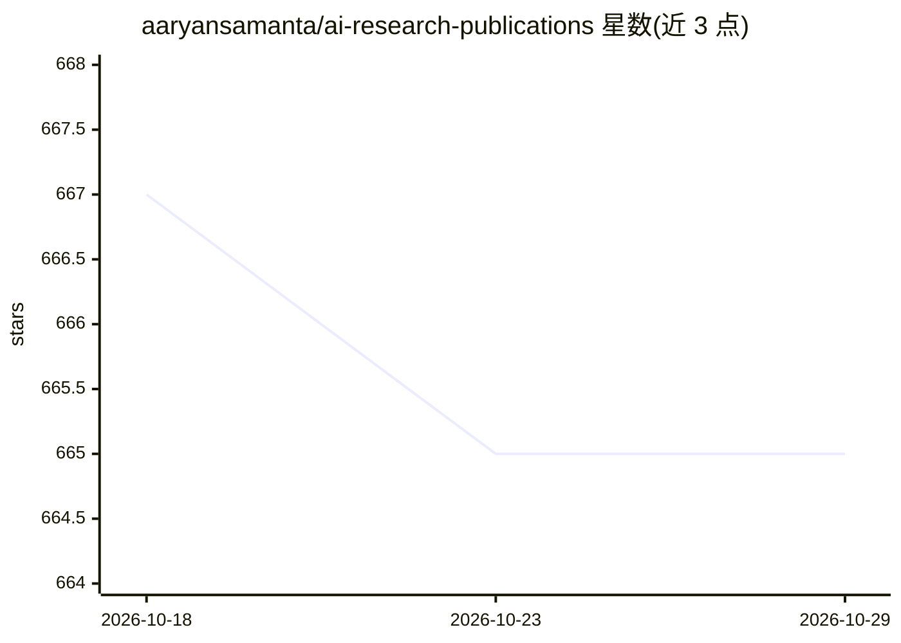

# aaryansamanta/ai-research-publications

⭐ 665 · HTML · 推送 2026-09-20 · [GitHub](https://github.com/aaryansamanta/ai-research-publications) · [官网](https://aaryansamanta.github.io/) · 个人维护

**高中生 AI/计算生物研究作品集：2 篇已发表论文+3 个在研项目**

个人研究作品集仓库，收录作者作为第一作者的 2 篇同行评审论文（IEEE AIAM 2025 量子启发 GA+GNN 融合分类、IJHSR 2026 秀丽隐杆线虫线粒体遗传学）及 3 个在研项目：斯坦福医学院盆底超声运动学分析、UCLA COSMOS 野火资源调度强化学习代理、生物教学图像误导性研究。每个项目目录含代码、论文、图表与引用文件，部分代码以 MIT 发布，临床数据不授权。

## 筛选速览

| 维度 | 判定 | 备注 |
|---|---|---|
| AI 角色 | `ai-knowledge` | 知识聚合/清单类 |
| 许可风险 | `none` | — |
| 部署形态 | `None` |  |
| 模型依赖 | — | README 未给出锁定关系 |
| 硬件要求 | — | 无带数字的原话,不猜 |
| 安装摩擦 | `low` | 无编译、无系统依赖或容器化 |
| 成熟度 | — | 结构信号不足 |

## 能力要点

- 2 篇已发表论文：量子启发 GA×GNN（IEEE AIAM 2025）与 C. elegans 线粒体比较基因组学（IJHSR）
- InfernoTactics 野火 RL 代理：CNN+MLP actor-critic，含 Cesium 3D 演示与 FastAPI 后端
- 各项目目录附带 CITATION.cff/.bib 与独立深度 README
- 部分项目代码 MIT 许可，临床数据不授权

## 适用场景

- 查阅高中生跨学科 AI 研究成果与论文原文
- 复现 QIHGA-GNN 分类实现与 SHAP 分析
- 引用其中论文（提供 BibTeX 与 DOI）

## 场景标签

 · 领域:科研/机器学习与计算生物学

## 证据(README 行号)

> L17: Lead author of two peer-reviewed publications (IEEE · IJHSR) as a high-school sophomore, plus three
> L41: |1|**Quantum-Inspired Hybrid GA + GNN Ensemble**|IEEE 7th Intl. Conf. on AI & Advanced Manufacturing (AIAM) 2025|Qu
> L44: |4|**InfernoTactics — Wildfire RL Agent**|UCLA COSMOS 2026, Cluster 1|Actor-critic reinforcement learning (CNN + ML

## 星数曲线

2026-10-18 667 → 2026-10-29 665（-2）

---
*卡片 v1 · prompt 1.4 · 生成 2026-10-21 · 置信度 high · 依据 README sha `d01f5d68b4ed` · [字段定义](../../DATASET.md)*
