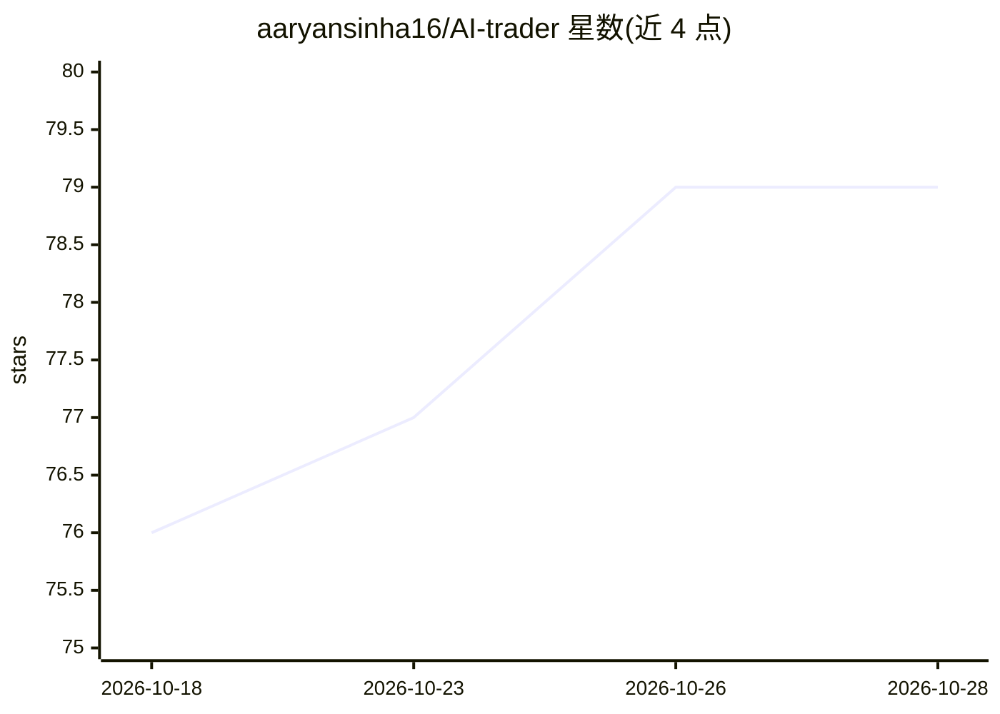

# aaryansinha16/AI-trader

⭐ 80 · Python · MIT · 推送 2026-07-09 · [GitHub](https://github.com/aaryansinha16/AI-trader) · 个人维护

**面向 NSE F&O 的日内期权算法交易研究平台（NIFTY）**

全栈日内期权交易研究与执行平台：通过 TrueData WebSocket 采集 tick 级行情存入 TimescaleDB，提供 tick 级回放回测引擎、每 30 秒运行的信号管线（3 种规则策略经 XGBoost 宏观/微观/分策略模型打分过滤）、Q-learning RL 出场代理、Kelly 仓位与动态止损，以及 Next.js 终端风格仪表盘。面向量化交易研究者与开发者，需自备 TrueData 数据凭证，支持 Diploi 一键部署；README 声明模型为实验性质，不保证盈利，非持牌交易平台。

## 筛选速览

| 维度 | 判定 | 备注 |
|---|---|---|
| AI 角色 | `ai-native` | 本体是模型或模型工具 |
| 许可风险 | `permissive` | MIT |
| 部署形态 | `library` | 以包/库形式分发 |
| 模型依赖 | — | README 未给出锁定关系 |
| 硬件要求 | — | 无带数字的原话,不猜 |
| 安装摩擦 | `low` | 无编译、无系统依赖或容器化 |
| 成熟度 | `idea` | |

## 能力要点

- tick 级回放回测引擎，与实盘同一管线
- XGBoost 宏观/微观/分策略模型 + Q-learning RL 出场代理
- 80 宏观指标 + 5 微观 tick 特征的信号管线（每 30 秒）
- Kelly 仓位、动态止损与三档风险配置（LOW/MEDIUM/HIGH）

## 适用场景

- 在真实历史 tick 数据上回测日内期权策略
- 盘后训练并迭代信号过滤与出场模型
- 通过仪表盘进行纸面交易与持仓监控

## 场景标签

`金融量化` · 领域:学习与行业

## 证据(README 行号)

> L39: |**ML Models**|XGBoost macro/micro/per-strategy models + Q-learning RL exit agent|
> L243: ## ML Models — Deep Dive

## 星数曲线

2026-10-18 76 → 2026-10-28 79（+3）

---
*卡片 v1 · prompt 1.4 · 生成 2026-10-24 · 置信度 mid · 依据 README sha `4ac0d213d7aa` · [字段定义](../../DATASET.md)*
