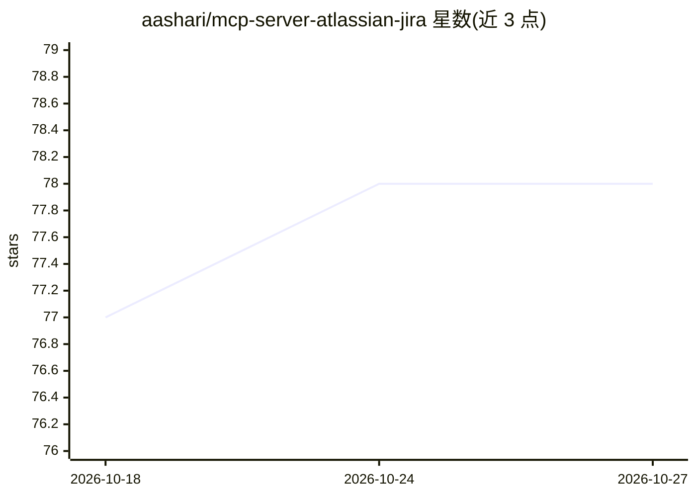

# aashari/mcp-server-atlassian-jira

⭐ 78 · TypeScript · 推送 2026-03-06 · [GitHub](https://github.com/aashari/mcp-server-atlassian-jira) · 个人维护

**让 AI 助手通过 MCP 操作 Jira 的 Node.js 服务器**

基于 Node.js/TypeScript 的 Atlassian Jira MCP server，向 Claude Desktop、Cursor 等支持 MCP 的 AI 助手暴露 5 个通用工具（jira_get/post/put/patch/delete），可访问任意 Jira Cloud REST API v3 端点：项目/issue 查询（JQL）、评论、worklog、用户与状态等。默认输出 TOON 格式（较 JSON 减少 30-60% token），支持 JMESPath 过滤、超 40k 字符自动截断并落盘原始响应。通过环境变量配置站点名/邮箱/API token，同时提供 CLI；限 Jira Cloud，不支持 Server/Data Center。

## 筛选速览

| 维度 | 判定 | 备注 |
|---|---|---|
| AI 角色 | `ai-ecosystem` | LLM/agent 周边工具 |
| 许可风险 | `none` | — |
| 部署形态 | `library` | 以包/库形式分发 |
| 模型依赖 | — | README 未给出锁定关系 |
| 硬件要求 | — | 无带数字的原话,不猜 |
| 安装摩擦 | `low` | 无编译、无系统依赖或容器化 |
| 成熟度 | — | 结构信号不足 |

## 能力要点

- 5 个通用 HTTP 方法工具覆盖任意 Jira REST API v3 端点
- TOON 输出格式宣称减少 30-60% token，可选 JSON
- JMESPath 过滤与大响应自动截断（原始响应存 /tmp 备查）
- CLI 与 MCP 工具同构，本地运行、使用自有凭据

## 适用场景

- 在 Claude Desktop/Cursor 中用自然语言查询和管理 Jira issue、评论与项目
- 通过 CLI 在终端直接调用 Jira REST API
- 团队用 AI 助手跟踪 sprint 进度、优先级与 bug 状态

## 场景标签

 · 领域:开发工具/项目管理集成

## 证据(README 行号)

> L63: Most AI assistants support MCP. Install the server globally:
> L84: ## Available Tools

## 星数曲线

2026-10-18 77 → 2026-10-27 78（+1）

---
*卡片 v1 · prompt 1.4 · 生成 2026-10-24 · 置信度 high · 依据 README sha `5fe0eeef2175` · [字段定义](../../DATASET.md)*
