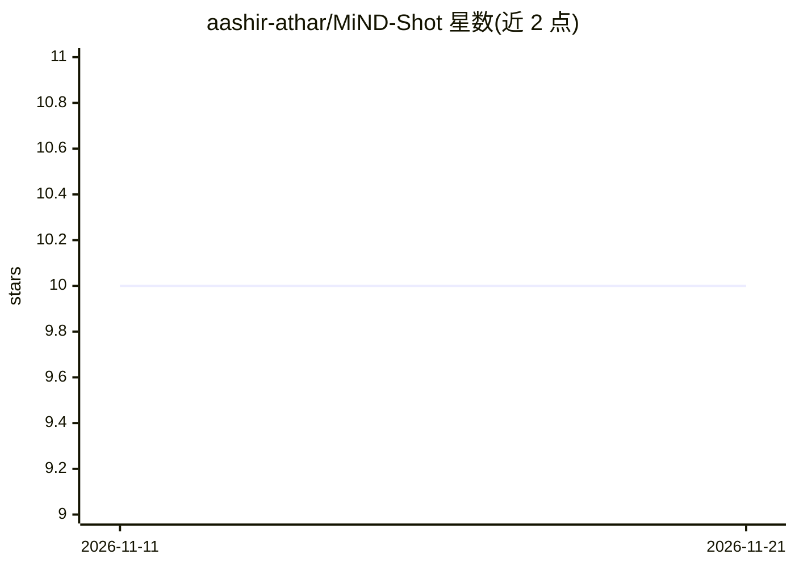

# aashir-athar/MiND-Shot

⭐ 10 · Python · 推送 2026-11-20 · [GitHub](https://github.com/aashir-athar/MiND-Shot) · [官网](https://aashir-athar.github.io/MiND-Shot/) · 个人维护

**跑在 GitHub Actions 上的 BTC/ETH 加密货币交易信号引擎，推送 Telegram 提醒**

纯 Python 标准库实现的无服务器加密货币信号引擎：以 GitHub Actions cron 定时轮询 Kraken 的 BTC/ETH 4h K 线，运行五个经 1,620 组回测筛选、样本外验证的均值回归策略，叠加在线自学习 ML 集成（贝叶斯上下文桶、FTRL-Proximal、Hedge 加权、漂移检测）对信号做二次打分与否决。信号经 Telegram Bot API 或 Make.com/n8n webhook 发送；状态以 JSON 提交回 Git 仓库，附自动生成的 React 回测报告页面。定位为决策支持工具，声明非投资建议。

## 筛选速览

| 维度 | 判定 | 备注 |
|---|---|---|
| AI 角色 | `ai-native` | 本体是模型或模型工具 |
| 许可风险 | `none` | — |
| 部署形态 | `library` | 以包/库形式分发 |
| 模型依赖 | — | README 未给出锁定关系 |
| 硬件要求 | — | 无带数字的原话,不猜 |
| 安装摩擦 | `low` | 无编译、无系统依赖或容器化 |
| 成熟度 | — | 结构信号不足 |

## 能力要点

- 5 个 ADX 门控均值回归策略，经样本外回测验证（60% 胜率门槛）
- 自学习在线 ML 集成对信号校准 P(win)，支持否决低置信信号，每周日走验重训
- 零第三方依赖，纯 Python 3.10+ 标准库，GitHub Actions 免费 cron 运行
- React/Vite 自动化回测仪表盘 + 326 行交易明细，每日亏损上限等风控

## 适用场景

- 免费接收 BTC/ETH 均值回归交易信号到 Telegram
- 学习无服务器定时任务如何编排交易引擎与 ML 重训流程
- 通过 CI 中的回测脚本自行复现策略胜率与净值曲线

## 场景标签

`金融量化` · 领域:学习与行业

## 证据(README 行号)

> L21: **MiND-Shot** is an open-source **crypto trading signal engine** — an **algorithmic trading bot** for **Bitcoin (BT
> L61: |🧠|**Self-learning ML**|Calibrated online ensemble — Bayesian context buckets, FTRL-Proximal logistic, cross-strate
> L162: 3. **Second opinion** — a self-learning **online ensemble** scores every setup with a calibrated P(win): Bayesian 

## 星数曲线

2026-11-11 10 → 2026-11-21 10（+0）

---
*卡片 v1 · prompt 1.4 · 生成 2026-11-20 · 置信度 mid · 依据 README sha `d196caa1126a` · [字段定义](../../DATASET.md)*
