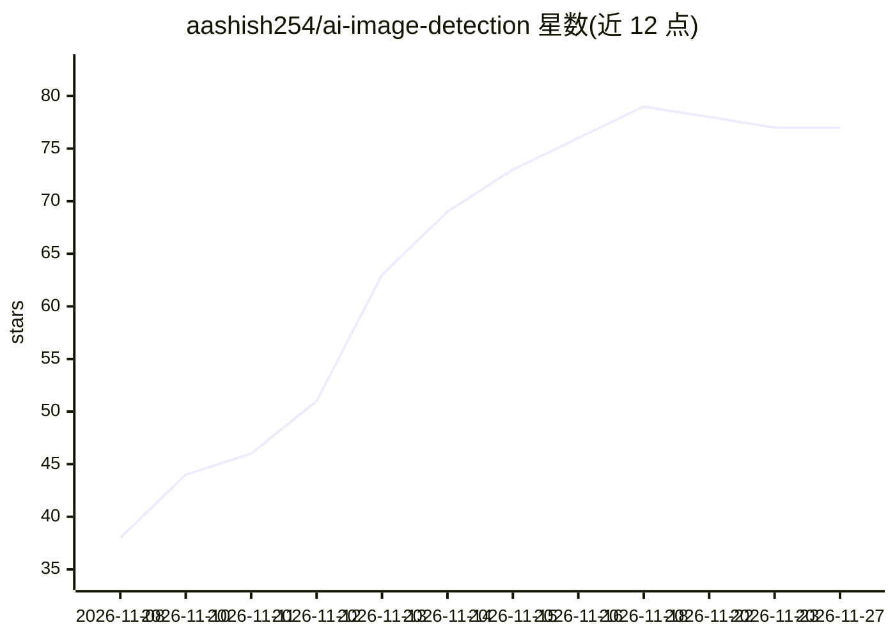

# aashish254/ai-image-detection

⭐ 77 · TypeScript · MIT · 推送 2026-11-23 · [GitHub](https://github.com/aashish254/ai-image-detection) · 组织维护

**多模态 AI 生成图像取证分析平台，输出五档判定报告**

基于 Next.js 14 前端与 Python FastAPI 模型服务器的图像取证分析应用：对单张图片运行七项测量（本地 ViT 分类器、Gemini 视觉读图、浏览器内 DCT 频域分析、水印/元数据级联、FSFN 融合、GAN 指纹、VPT 伪影定位），三项加权融合为五档判定（AI_GENERATED 到 REAL），并给出伪影空间图、六种生成器归因、可靠性评估与 PDF 报告。需 Node.js 与 Python 环境，分类器必需，VPT 哨兵需 CUDA GPU（无则降级为 demo 模式）。作者明确声明无公开准确率基准。

## 筛选速览

| 维度 | 判定 | 备注 |
|---|---|---|
| AI 角色 | `ai-native` | 本体是模型或模型工具 |
| 许可风险 | `permissive` | MIT |
| 部署形态 | `library` | 以包/库形式分发 |
| 模型依赖 | — | README 未给出锁定关系 |
| 硬件要求 | `cpu-ok` | |
| 安装摩擦 | `medium` | 含编译或系统依赖之一 |
| 成熟度 | — | 结构信号不足 |

## 能力要点

- 七项独立测量融合为五档判定，展示各读数置信度与时延
- 六种生成器画像归因与 SynthID/C2PA/SD 水印级联扫描
- 伪影区域坐标与严重度空间图（哨兵需 CUDA，否则降级）
- 报告以文本排版导出 PDF，历史记录存于浏览器 localStorage

## 适用场景

- 鉴定一张图片是否为 AI 生成并获取多读数对比报告
- 尝试归因图像出自哪类生成器（DALL-E/Midjourney/SD 等）
- 定位图像中的伪影区域并导出 PDF 取证报告

## 场景标签

 · 领域:计算机视觉/AI 内容检测

## 证据(README 行号)

> L7: OriginLayer runs seven independent measurements over one image and issues one report. Three of
> L43: |Local classifier|`Organika/sdxl-detector`, a ViT image classifier|Python server, `POST /classify-json`|30%|

## 星数曲线

2026-11-08 38 → 2026-11-27 77（+39）

---
*卡片 v1 · prompt 1.4 · 生成 2026-11-18 · 置信度 high · 依据 README sha `3583bed12f43` · [字段定义](../../DATASET.md)*
