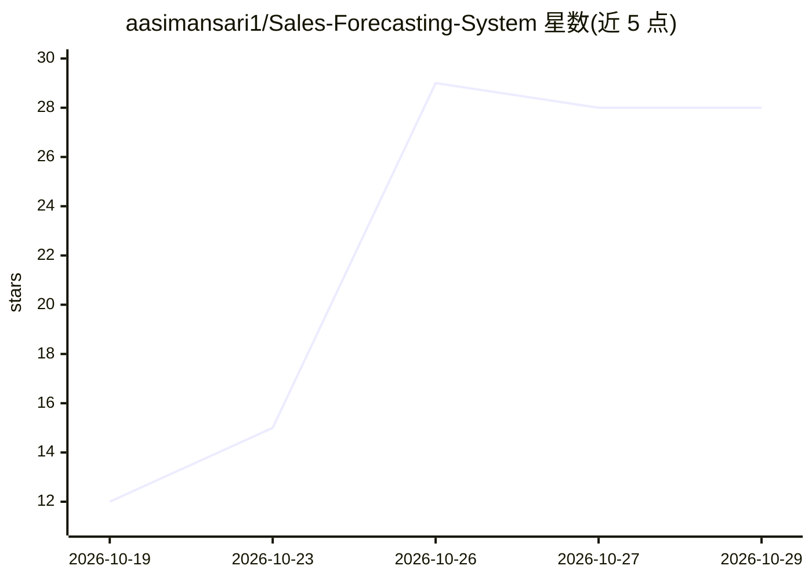

# aasimansari1/Sales-Forecasting-System

⭐ 28 · JavaScript · MIT · 推送 2026-08-23 · [GitHub](https://github.com/aasimansari1/Sales-Forecasting-System) · 个人维护

**全栈销售预测平台：5 种 ML 模型预测销量并管理库存**

面向业务分析场景的全栈销售预测系统：上传 CSV/XLSX 交易数据后，可训练 Linear Regression、XGBoost、ARIMA、Prophet、LSTM 五种模型生成预测，并以 RMSE/MAE/R²/MAPE 对比模型表现。另含 Isolation Forest 异常检测、RFM 客户分层、库存安全库存与补货点计算、报表 CSV 导出。技术栈为 React 前端 + FastAPI 后端 + PostgreSQL，通过 Docker Compose 部署；随附脚本生成 21.1 万行示例数据。

## 筛选速览

| 维度 | 判定 | 备注 |
|---|---|---|
| AI 角色 | `ai-native` | 本体是模型或模型工具 |
| 许可风险 | `permissive` | MIT |
| 部署形态 | `self-host` | docker 或自建部署 |
| 模型依赖 | — | README 未给出锁定关系 |
| 硬件要求 | — | 无带数字的原话,不猜 |
| 安装摩擦 | `low` | 无编译、无系统依赖或容器化 |
| 成熟度 | — | 结构信号不足 |

## 能力要点

- 五种可训练模型：Linear Regression/XGBoost/ARIMA/Prophet/LSTM
- Isolation Forest 异常检测与 RFM 客户分层
- 库存安全库存、补货点与建议订货量计算
- 拖放式 CSV/XLSX 上传与自动列检测

## 适用场景

- 上传销售数据预测未来收入与销量
- 对比多种模型的表现选型
- 基于需求预测获得补货提醒
- 按 RFM 分层查看客户群与异常交易

## 场景标签

`数据分析` · 领域:效率与自动化

## 证据(README 行号)

> L5:  An AI-powered, full-stack sales forecasting platform with five ML models,
> L54: |**Forecasting**|Train Linear Regression, XGBoost, ARIMA, Prophet, or LSTM; poll job status; view predictions|

## 星数曲线

2026-10-19 12 → 2026-10-29 28（+16）

---
*卡片 v1 · prompt 1.4 · 生成 2026-10-26 · 置信度 high · 依据 README sha `20d1b3992a76` · [字段定义](../../DATASET.md)*
