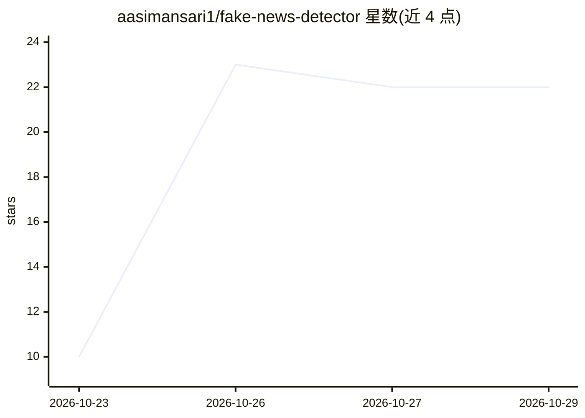

# aasimansari1/fake-news-detector

⭐ 22 · Jupyter Notebook · MIT · 推送 2026-08-23 · [GitHub](https://github.com/aasimansari1/fake-news-detector) · [官网](https://github.com/aasimansari1/fake-news-detector) · 个人维护

**输入新闻文本即输出真假判定与置信度的 NLP 分类器**

基于 TF-IDF 特征与 scikit-learn 的假新闻分类 Web 应用：训练时对比 Passive Aggressive、Naive Bayes、Logistic Regression、Random Forest 四种模型并自动选用最优（样例数据集约 91% 准确率），通过 Flask 提供 Web 界面与 POST /predict REST API，返回真假判定、置信度与影响判定的关键词。附训练 notebook 与可视化（混淆矩阵、ROC 曲线等）。样例数据集较小，README 提示生产环境需替换为更大数据集。

## 筛选速览

| 维度 | 判定 | 备注 |
|---|---|---|
| AI 角色 | `ai-native` | 本体是模型或模型工具 |
| 许可风险 | `permissive` | MIT |
| 部署形态 | `library` | 以包/库形式分发 |
| 模型依赖 | — | README 未给出锁定关系 |
| 硬件要求 | — | 无带数字的原话,不猜 |
| 安装摩擦 | `low` | 无编译、无系统依赖或容器化 |
| 成熟度 | — | 结构信号不足 |

## 能力要点

- 4 种模型训练对比并自动选用最优模型
- POST /predict JSON API，可接入任意应用或浏览器扩展
- 可解释输出：置信度、真假概率与触发判定的关键词
- 训练可视化：准确率对比、混淆矩阵、ROC 曲线、Top 20 预测词

## 适用场景

- 粘贴新闻标题或文章获取真假判定与置信度
- 将假新闻检测作为 REST API 接入自己的应用
- 通过 notebook 学习 NLP 分类模型的训练与评估流程

## 场景标签

`教程课程` · 领域:学习与行业

## 证据(README 行号)

> L14: > FakeShield uses NLP and machine learning to classify news articles in milliseconds — with a confidence score, fak
> L19: - 4 models compared: Passive Aggressive, Naive Bayes, Logistic Regression, Random Forest

## 星数曲线

2026-10-23 10 → 2026-10-29 22（+12）

---
*卡片 v1 · prompt 1.4 · 生成 2026-10-27 · 置信度 mid · 依据 README sha `204cf967bc8c` · [字段定义](../../DATASET.md)*
