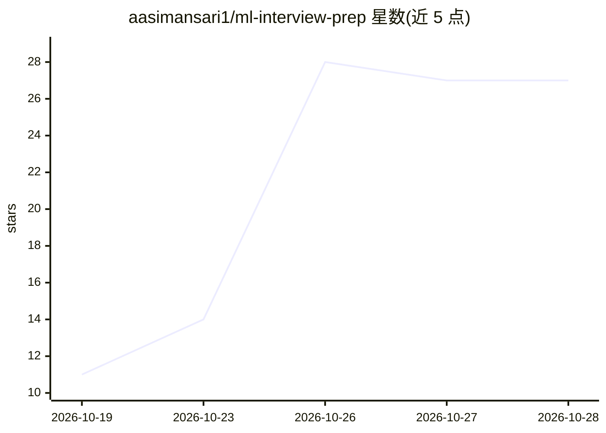

# aasimansari1/ml-interview-prep

⭐ 27 · 推送 2026-05-18 · [GitHub](https://github.com/aasimansari1/ml-interview-prep) · 个人维护

**面向求职者的 500+ ML/AI 面试问答与速查参考库**

以 Markdown 问答形式组织的机器学习/人工智能面试参考资料：覆盖 ML 基础、数学统计、深度学习、NLP、计算机视觉、ML 系统设计、Python 库速查、编码模式与行为面试等章节。每条问题配有概念解释、对比表格与 Python/PyTorch/scikit-learn 代码示例，面向准备 Google DeepMind、OpenAI、Meta AI 等公司面试的候选人。仓库为纯文档内容，无需安装运行。

## 筛选速览

| 维度 | 判定 | 备注 |
|---|---|---|
| AI 角色 | `ai-knowledge` | 知识聚合/清单类 |
| 许可风险 | `permissive` | — |
| 部署形态 | `None` |  |
| 模型依赖 | — | README 未给出锁定关系 |
| 硬件要求 | — | 无带数字的原话,不猜 |
| 安装摩擦 | `low` | 无编译、无系统依赖或容器化 |
| 成熟度 | — | 结构信号不足 |

## 能力要点

- 500+ 面试问答配代码示例
- 覆盖 ML 基础/深度学习/NLP/CV/系统设计等章节
- NumPy、Pandas、PyTorch、scikit-learn 速查单

## 适用场景

- 我准备大厂 ML/AI 岗位面试时系统复习知识点
- 快速查阅算法概念与对应代码写法
- 学习 ML 系统设计题（推荐系统、欺诈检测）的答题思路

## 场景标签

`教程课程` · 领域:学习与行业

## 证据(README 行号)

> L6: **The most complete, interview-focused ML/AI reference on GitHub.**
> L12: |Section|Content|

## 星数曲线

2026-10-19 11 → 2026-10-28 27（+16）

---
*卡片 v1 · prompt 1.4 · 生成 2026-10-26 · 置信度 high · 依据 README sha `6731173ae859` · [字段定义](../../DATASET.md)*
