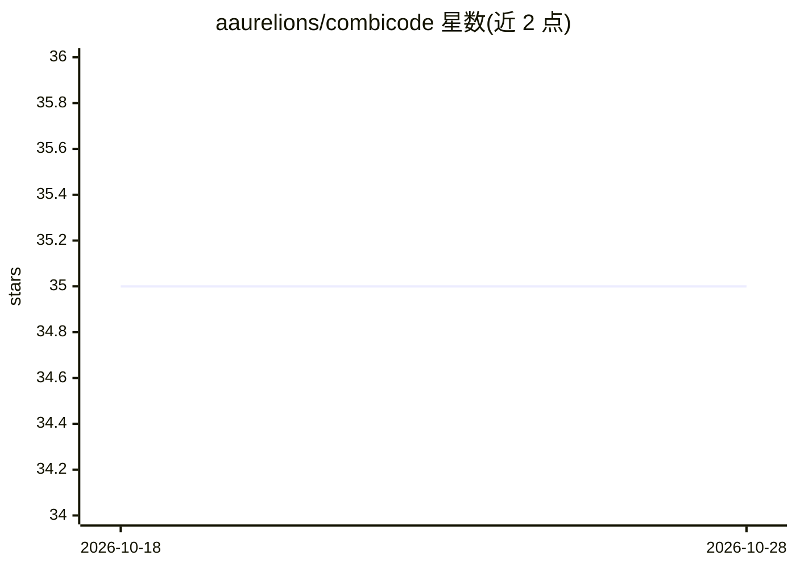

# aaurelions/combicode

⭐ 35 · Rust · MIT · 推送 2026-10-14 · [GitHub](https://github.com/aaurelions/combicode) · 个人维护

**把项目代码库打包成单个文本文件供 LLM 使用的 CLI 工具**

Rust 编写的单二进制 CLI 工具 Combicode：将项目目录打包为一个文本文件，内含提示词、代码地图（目录树+每文件的类/函数大纲及精确行号）与完整源码，供输入给 LLM。支持 include/exclude 模式过滤、遵循 gitignore、内置 code/docs 提示词，并可将输出文件 restore 还原为原文件（含路径安全校验）。大纲用启发式而非完整解析器识别，覆盖 Python/JS/TS/Rust/Go/C 系等多语言。通过 npm/PyPI 分发同一预编译二进制，也支持 cargo、Homebrew 安装。

## 筛选速览

| 维度 | 判定 | 备注 |
|---|---|---|
| AI 角色 | `ai-ecosystem` | LLM/agent 周边工具 |
| 许可风险 | `permissive` | MIT |
| 部署形态 | `library` | 以包/库形式分发 |
| 模型依赖 | — | README 未给出锁定关系 |
| 硬件要求 | — | 无带数字的原话,不猜 |
| 安装摩擦 | `low` | 无编译、无系统依赖或容器化 |
| 成熟度 | — | 结构信号不足 |

## 能力要点

- 打包结果含提示词、带精确行号的代码地图与完整源码三部分
- combicode restore 可将输出文件还原回原文件，含路径安全校验
- gitignore 语法过滤与内置 code/docs 提示词
- 单原生二进制，npm/PyPI/brew/cargo 均分发预编译版本

## 适用场景

- 把整个代码库交给 LLM 做分析或问答前生成上下文文件
- 生成带函数大纲和行数统计的增强版 tree 视图
- 在 LLM 输出文件与真实文件之间往返同步

## 场景标签

 · 领域:开发者工具/LLM 上下文

## 证据(README 行号)

> L8: Combicode packs a project into one text file that you can give to an LLM. The file contains:
> L16: Combicode is a single native binary written in Rust. The npm and PyPI packages contain the same binary, so you do n

## 星数曲线

2026-10-18 35 → 2026-10-28 35（+0）

---
*卡片 v1 · prompt 1.4 · 生成 2026-10-25 · 置信度 high · 依据 README sha `3d61bcdb43a9` · [字段定义](../../DATASET.md)*
