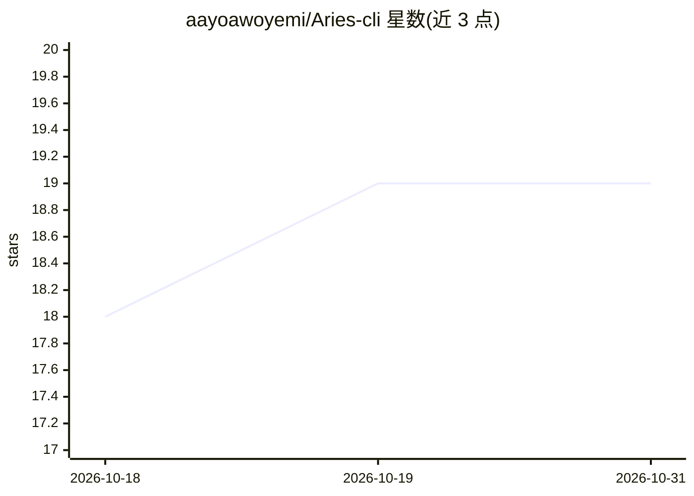

# aayoawoyemi/Aries-cli

⭐ 19 · TypeScript · Apache-2.0 · 推送 2026-05-08 · [GitHub](https://github.com/aayoawoyemi/Aries-cli) · [官网](https://orimnemos.com) · 个人维护

**带持久记忆与 REPL 体的终端 agentic 编码 harness**

面向软件工程的终端 agent harness（Ori CLI）：管理 agentic 循环——prompt 组装、模型调用、工具分发、上下文管理与记忆持久化。模型无关，可路由至 Anthropic、OpenAI、DeepSeek、Ollama 等及 llama.cpp 服务的本地 GGUF 模型，用户自带 API key。两个核心组件：常驻 Python 子进程 REPL 体（tree-sitter 解析、rustworkx 图索引整个仓库，提供结构分析与判断操作如 PageRank 排名、Louvain 社区检测、重复检测）；以及 Ori Mnemos 原生集成（跨会话持久记忆、四信号检索、warm context、Echo/Fizzle 反馈回路）。当前为 v0.1.0-beta，文档待完善。

## 筛选速览

| 维度 | 判定 | 备注 |
|---|---|---|
| AI 角色 | `ai-ecosystem` | LLM/agent 周边工具 |
| 许可风险 | `permissive` | Apache-2.0 |
| 部署形态 | `library` | 以包/库形式分发 |
| 模型依赖 | local-ok | 支持本地模型 |
| 硬件要求 | — | 无带数字的原话,不猜 |
| 安装摩擦 | `low` | 无编译、无系统依赖或容器化 |
| 成熟度 | `idea` | |

## 能力要点

- tree-sitter + rustworkx 图索引的 REPL 体，提供 PageRank/HITS/Louvain 等结构查询
- rlm_call 递归子 LLM 调用（并行、深度受限、调用数有上限）
- Ori Mnemos 跨会话持久记忆：身份/目标/知识图谱/项目脑四类持久层
- 模型无关路由，支持 9 家以上提供商与 OpenAI 兼容端点及本地 GGUF

## 适用场景

- 在终端里以 agent 方式进行软件工程任务并跨会话保留记忆
- 让 agent 基于代码依赖图做结构化导航与重复检测
- 接入自有 API key 的多家模型或在本地 llama.cpp/Ollama 上运行

## 场景标签

`编码 Agent` `Agent 记忆` · 领域:Agent 开发

## 证据(README 行号)

> L20: Ori CLI is a terminal-based agent harness for software engineering. It manages the agentic loop — prompt assembly, 
> L22: The harness is model-agnostic. It routes to Anthropic, Google, OpenAI, DeepSeek, Moonshot, Groq, OpenRouter, Ollama

## 星数曲线

2026-10-18 18 → 2026-10-31 19（+1）

---
*卡片 v1 · prompt 1.4 · 生成 2026-10-28 · 置信度 high · 依据 README sha `bb81baf3eea5` · [字段定义](../../DATASET.md)*
