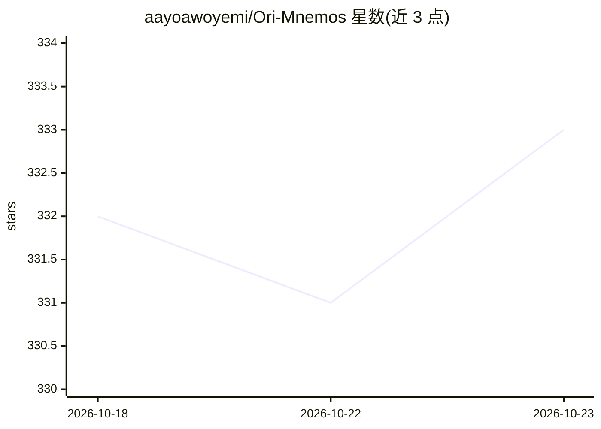

# aayoawoyemi/Ori-Mnemos

⭐ 333 · TypeScript · Apache-2.0 · 推送 2026-10-01 · [GitHub](https://github.com/aayoawoyemi/Ori-Mnemos) · [官网](https://orimnemos.com.) · 个人维护

**本地优先的 AI agent 持久记忆基础设施（MCP 服务+CLI+库）**

面向 AI agent 的持久记忆系统：以 Markdown 磁盘文件为事实源、SQLite 派生索引，用 wiki-link 构建知识图，结合 ACT-R 激活衰减、扩散激活、Hebbian 共现与检索强化学习实现自优化检索；支持 supersede/release/purge 遗忘操作。提供三种使用面：npx CLI、MCP server（`ori serve`，供 agent 调用 `ori_recall`）与 TypeScript 库（`recall`/`searchComposite` 导出，semver 契约）。全程无 API key、无网络；学习态数据（Q 值、LinUCB、检索历史）不随索引重建导出，删除前需手动导出。README 报告 ForgetEval/HotpotQA/LoCoMo/LongMemEval-S 四组自测基准并附复现命令。

## 筛选速览

| 维度 | 判定 | 备注 |
|---|---|---|
| AI 角色 | `ai-ecosystem` | LLM/agent 周边工具 |
| 许可风险 | `permissive` | Apache-2.0 |
| 部署形态 | `library` | 以包/库形式分发 |
| 模型依赖 | — | README 未给出锁定关系 |
| 硬件要求 | — | 无带数字的原话,不猜 |
| 安装摩擦 | `low` | 无编译、无系统依赖或容器化 |
| 成熟度 | — | 结构信号不足 |

## 能力要点

- Markdown 为事实源 + SQLite 派生索引，Git 版本控制，无数据库锁定
- ACT-R 激活衰减/扩散激活/检索强化学习驱动的认知式检索
- MCP server、CLI、TypeScript 库三种使用面共用同一 recall 入口
- 支持 supersede/release/purge 遗忘原语，离线运行无需 API key

## 适用场景

- 让 AI agent 跨会话、跨客户端保留与检索长期记忆
- 通过 MCP 客户端以 `ori serve` 接入 agent 工作流
- 在程序中以库形式对本地知识库做导航式多跳检索
- 按需让系统遗忘（软驱逐/硬删除）指定事实

## 场景标签

`Agent 记忆` · 领域:Agent 开发

## 证据(README 行号)

> L3: **Open-source persistent memory infrastructure for AI agents.**
> L26: **MCP server** — `ori serve`, registered in a client config. This is how an
> L29: **Library** — `recall` is the same wired entry the CLI and the MCP

## 星数曲线

2026-10-18 332 → 2026-10-23 333（+1）

---
*卡片 v1 · prompt 1.4 · 生成 2026-10-21 · 置信度 high · 依据 README sha `cc89bf2a76f1` · [字段定义](../../DATASET.md)*
