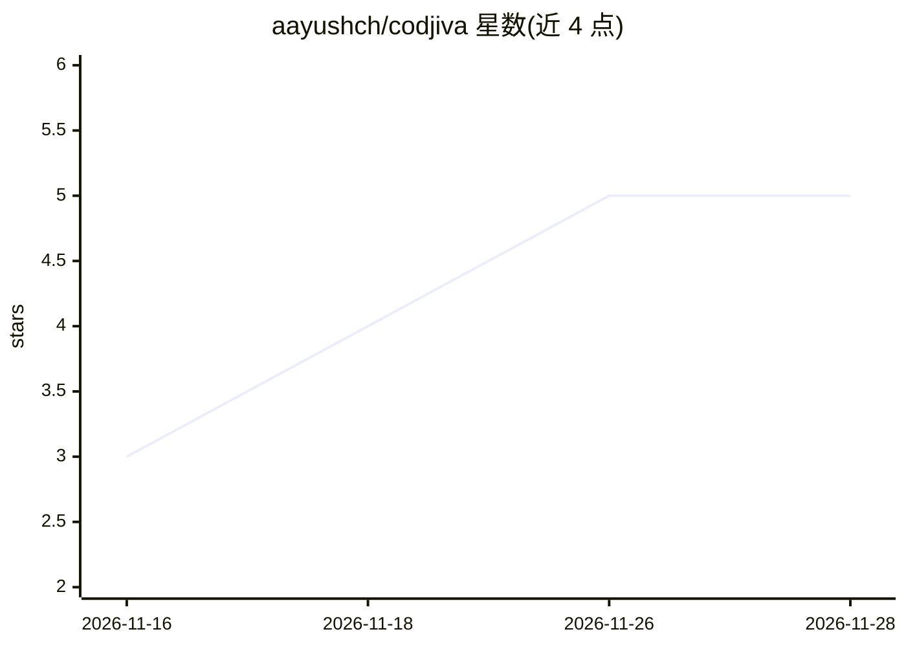

# aayushch/codjiva

⭐ 5 · Rust · Apache-2.0 · 推送 2026-11-27 · [GitHub](https://github.com/aayushch/codjiva) · 个人维护

**面向开发者的代码可视化桌面应用：AI 将代码绘制为蓝图与动画**

Codjiva 是用 Tauri 和 Svelte 构建的桌面应用（macOS/Windows/Linux），打开项目文件夹后由用户已配置的 AI agent 读取代码，生成多种可视化产物：静态交互蓝图（Visual）、带旁白的讲解短片（Film）、可单步运行的状态图（Step-through）、Schema/Lanes/Structure/Map 四种数据视图，以及跨文件 pipeline 拼接（Compose）。产物为纯 HTML 存于项目内 .codjiva/ 目录，可离线在浏览器打开；每次生成记录源文件哈希，代码变更后产物标记为 stale。

## 筛选速览

| 维度 | 判定 | 备注 |
|---|---|---|
| AI 角色 | `ai-native` | 本体是模型或模型工具 |
| 许可风险 | `permissive` | Apache-2.0 |
| 部署形态 | `library` | 以包/库形式分发 |
| 模型依赖 | local-ok | 支持本地模型 |
| 硬件要求 | — | 无带数字的原话,不猜 |
| 安装摩擦 | `low` | 无编译、无系统依赖或容器化 |
| 成熟度 | — | 结构信号不足 |

## 能力要点

- 六种视图（Visual/Film/Step-through/Schema/Lanes/Structure/Map 等）从代码数据自动布局
- 产物为纯 HTML，保存在项目 .codjiva/ 文件夹，单文件离线可打开
- 支持 Claude Code、Cursor Agent 等已有 agent 程序，或直接用 API key 调用服务商
- 基于源文件哈希的 stale 标记与版本列表，不自动重新生成

## 适用场景

- 接手陌生 Go/Python/Java 项目时生成蓝图了解代码结构
- 为解析器、状态机类代码生成可单步执行的状态图
- 制作带旁白的短片讲解一个请求在代码中的流转
- 在文件夹级 Map 视图中浏览项目结构与函数分布

## 场景标签

 · 领域:开发者工具/代码可视化

## 证据(README 行号)

> L3: Codjiva is a desktop app that looks like a code editor but shows a **picture of the code** in place of its text.
> L4: You open a folder, pick a file, and an AI agent you already use reads the code and draws how it works.
> L30: Codjiva runs on macOS, Windows and Linux. It is built with Tauri and Svelte.
> L41: |**An API key**|For Anthropic, OpenAI, Google Gemini, or any server that speaks the OpenAI chat format (OpenRouter,

## 星数曲线

2026-11-16 3 → 2026-11-28 5（+2）

---
*卡片 v1 · prompt 1.4 · 生成 2026-11-21 · 置信度 high · 依据 README sha `d9f526715a41` · [字段定义](../../DATASET.md)*
