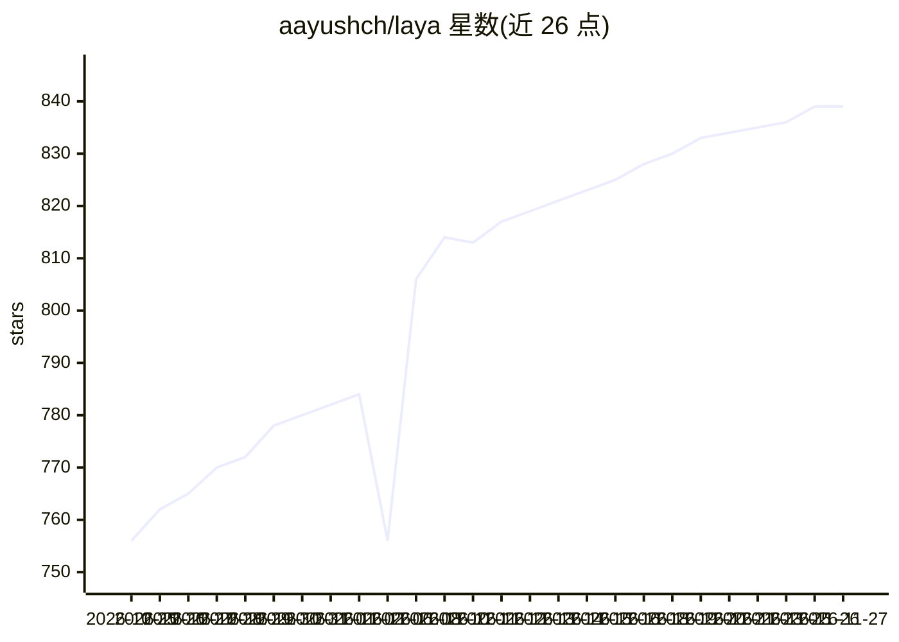

# aayushch/laya

⭐ 839 · Python · Apache-2.0 · 推送 2026-11-21 · [GitHub](https://github.com/aayushch/laya) · [官网](https://laya.aay.sh) · 个人维护

**本地优先的 AI 通知指挥台：聚合工作工具通知并预拟行动**

Laya 是开源桌面应用，聚合 Slack、Gmail、GitHub、Jira、Notion、Outlook、日历等工具的通知，用本地 LLM（Ollama/LM Studio）或自带 API key 的云端模型做分类、研究与行动暂存，以可审批的 Action Card 呈现。技术栈为 Tauri v2 + Svelte 5 + Python/FastAPI，检索层结合 ChromaDB 向量搜索与 SQLite FTS5 的 BM25（RRF 融合）；通过本地 n8n 做集成网关。支持多 persona 路由、预算跟踪、审计导出与三级隐私分类。提供预构建安装包，也可从源码开发。

## 筛选速览

| 维度 | 判定 | 备注 |
|---|---|---|
| AI 角色 | `ai-native` | 本体是模型或模型工具 |
| 许可风险 | `permissive` | Apache-2.0 |
| 部署形态 | `desktop` | 安装包/桌面程序 |
| 模型依赖 | local-ok | 支持本地模型 |
| 硬件要求 | — | 无带数字的原话,不猜 |
| 安装摩擦 | `low` | 无编译、无系统依赖或容器化 |
| 成熟度 | — | 结构信号不足 |

## 能力要点

- 多 persona 路由（Engineer/Comms/Ops/Sales/HR/Finance）与 AI 优先级排序
- Card Workspace 中与编码代理（Claude Code、Gemini CLI、Codex 等）多步协作
- 本地混合检索：ChromaDB 向量 + SQLite FTS5 BM25 经 RRF 融合
- Corpus 本地文档解析/嵌入/索引，聊天引用页级出处，工具经 MCP 暴露

## 适用场景

- 把 Slack/邮件/工单通知统一聚合并让 AI 预先拟好回复草稿
- 在本地优先、隐私分级的约束下处理工作事件流
- 跨平台追踪同一个人、工单或 PR 的关联脉络
- 用本地文档库（Corpus）做带引用的问答

## 场景标签

`AI 助手` `文档解析` `文档问答` · 领域:对话与助手

## 证据(README 行号)

> L8: Laya is an open-source, local-first AI notification command center that aggregates Slack, Gmail, GitHub, Jira, Notio
> L41: - **Multi-persona brain:** Routes events to specialized AI personas (Engineer, Comms, Ops, Sales, HR, Finance) with
> L64: - **Privacy-aware:** Three-tier data classification with cloud/local processing options

## 星数曲线

2026-10-25 756 → 2026-11-27 839（+83）

---
*卡片 v1 · prompt 1.4 · 生成 2026-11-24 · 置信度 mid · 依据 README sha `a3d1c37c9b40` · [字段定义](../../DATASET.md)*
