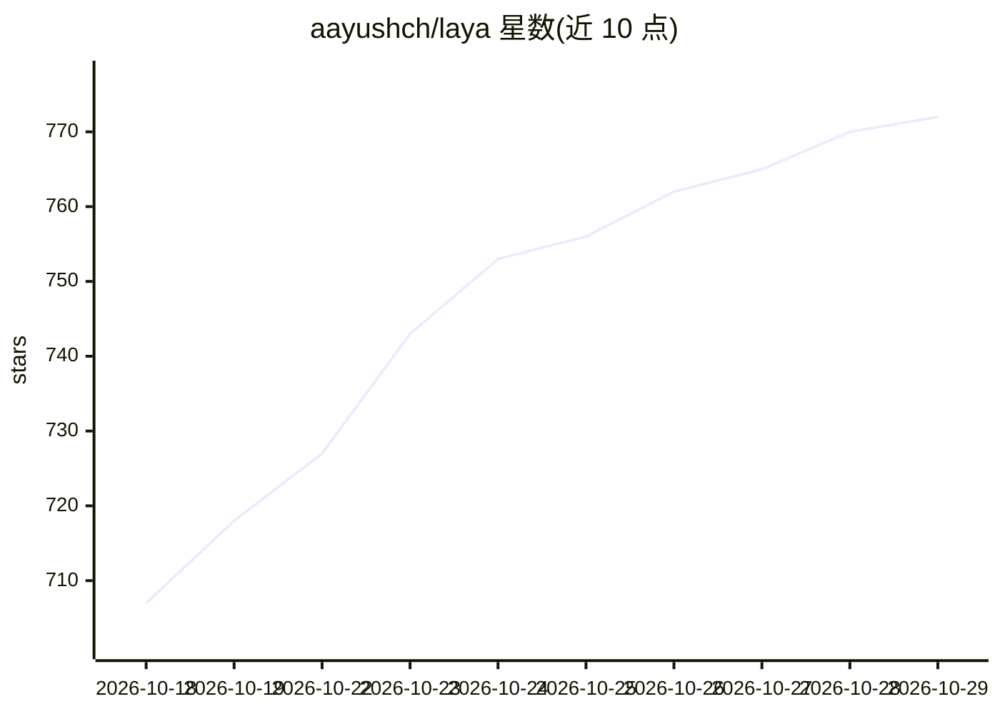

# aayushch/laya

⭐ 772 · Python · Apache-2.0 · 推送 2026-10-28 · [GitHub](https://github.com/aayushch/laya) · [官网](https://laya.aay.sh) · 个人维护

**本地优先的 AI 通知聚合指挥中心：整合办公工具事件并生成可批准的操作卡片**

桌面应用（Tauri v2 + Python FastAPI 后端），聚合 Slack、Gmail、GitHub、Jira、Notion、Outlook、日历等来源的通知，经本地 LLM（Ollama / LM Studio）或 BYOK 云模型的多 persona agent 做分类、研究并与跨平台实体关联，产出待批准的 Action Cards。功能包括文档索引（Corpus）、跨平台实体搜索（Coherence）、每日简报、预算追踪、出站操作（Egress）等。预构建安装包覆盖 macOS/Windows/Linux，支持自建 Bitbucket Server 与 GitHub Enterprise，数据按三级分类提供云/本地处理选项。

## 筛选速览

| 维度 | 判定 | 备注 |
|---|---|---|
| AI 角色 | `ai-native` | 本体是模型或模型工具 |
| 许可风险 | `permissive` | Apache-2.0 |
| 部署形态 | `desktop` | 安装包/桌面程序 |
| 模型依赖 | local-ok | 支持本地模型 |
| 硬件要求 | — | 无带数字的原话,不猜 |
| 安装摩擦 | `low` | 无编译、无系统依赖或容器化 |
| 成熟度 | — | 结构信号不足 |

## 能力要点

- 多 persona agent 管道对通知做分类、优先级排序与行动预演，产出待批准 Action Cards
- 本地 LLM（Ollama/LM Studio）或 BYOK 云模型（Anthropic/OpenAI/Google，经 LiteLLM）
- Corpus 本地文档索引（PDF/DOCX/Markdown 等）与页级引用问答，混合检索（ChromaDB 向量 + SQLite FTS5 BM25）
- CLI agent（Claude Code/Codex/Gemini/Pi）可作工作区 agent 或推理后端

## 适用场景

- 把 Slack/Gmail/Jira 等多来源通知统一到一个带 AI 处理的桌面端
- 早上看一份由 AI 生成的隔夜活动简报与当日日程
- 跨平台追踪某人、工单或 PR 的关联脉络并直接执行回复/评论等出站操作

## 场景标签

`AI 助手` `文档问答` · 领域:对话与助手

## 证据(README 行号)

> L8: Laya is an open-source, local-first AI notification command center that aggregates Slack, Gmail, GitHub, Jira, Notio
> L41: - **Multi-persona brain:** Routes events to specialized AI personas (Engineer, Comms, Ops, Sales, HR, Finance) with
> L54: - **Corpus:** Drop a PDF, DOCX, Markdown, text, CSV, JSON, or HTML file anywhere in the app and Laya parses, chunks

## 星数曲线

2026-10-18 707 → 2026-10-29 772（+65）

---
*卡片 v1 · prompt 1.4 · 生成 2026-10-21 · 置信度 mid · 依据 README sha `33f85a4f9403` · [字段定义](../../DATASET.md)*
